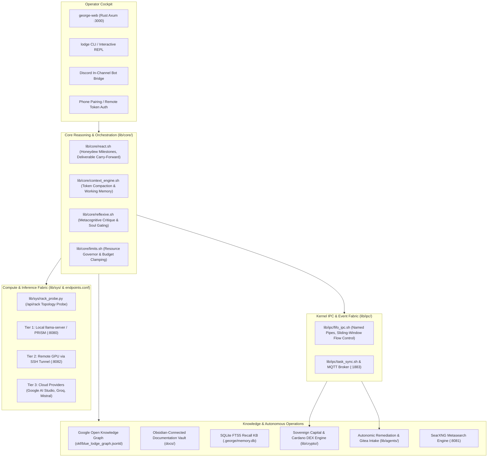

# Blue Lodge Sovereign Architecture Guide

> **System Blueprint & Technical Specification**  
> **Classification**: Sovereign Local AI Infrastructure  
> **Repository**: `github.com/dabe-19/blue-lodge`

---

## 1. Executive System Overview

Blue Lodge is an autonomous, local-first sovereign agentic development and capital operations workstation named **George**. Combining a robust, pure POSIX Bash-native reasoning core with a zero-latency Rust Axum web sidecar, an on-device PRISM inference fabric, a kernel-level named-pipe IPC flow control engine, and a formal Google Open Knowledge Graph (OKF), Blue Lodge operates entirely on self-hosted hardware without mandatory external cloud dependencies.



---

## 2. Service Inventory & Network Bindings

All services bind to localhost (`127.0.0.1`) by default to guarantee air-gapped security unless remote pairing is explicitly enabled:

| Service Name | Technology / Daemon | Default Port | Description |
| :--- | :--- | :--- | :--- |
| **Sovereign Web Sidecar** (`george-web`) | Rust (Axum, Tokio, Tower) | `3000` (HTTP/WS) | Operator workbench, chat PTY, Instrument Rack pane, Model Workbench, status lights, phone pairing. |
| **Gitea Local Forge** (`george-gitea`) | Docker (`gitea/gitea:latest`) | `3001` (HTTP), `2222` (SSH) | Fully self-hosted code repository, issue intake, and PR review gateway. |
| **Act Runner** (`george-act-runner`) | Docker (`gitea/act_runner:latest`) | Stdio / Unix Socket | Automated CI/CD runner executing tests, lint checks, and security verification. |
| **PRISM Primary Inference** | Docker / Native `llama-server` | `8080` (HTTP) | Tier 1 local CUDA LLM reasoning (`llama-server -m <approved_model>.gguf`). |
| **Remote GPU Tunnel** | OpenSSH Port Forwarding | `8082` (HTTP) | Tier 2 remote Proxmox or secondary workstation GPU tunnel. |
| **SearXNG Metasearch** (`george-searxng`) | Docker (`searxng/searxng:latest`)| `8081` (HTTP) | Keyless aggregate search across 70+ search engines with degraded engine detection. |
| **Mosquitto MQTT Broker** (`george-mosquitto`)| Docker (`eclipse-mosquitto:latest`) | `1883` (TCP) | High-speed pub/sub message bus for event triggers, telemetry, and OSINT sweeps. |

---

## 3. Directory Layout & Repository Anatomy

```
blue-lodge/
├── .agents/              # Custom agent workflows, specialists, and IDE rules
├── .george/              # George runtime state, sessions, telemetry, and cache
│   ├── discord_sessions/ # Discord conversation logs, outbox ledgers, and history
│   ├── ipc/channels/     # Active FIFO named pipes and keeper processes
│   ├── memory.db         # SQLite FTS5 vector and full-text recall database
│   ├── runs/             # Trajectory logs for all completed ReAct runs
│   ├── state/            # Search health, feature flags, and active remediations
│   └── telemetry/        # Incident snapshots, crash traces, and SHA256 fingerprints
├── bin/                  # CLI launcher binaries (lodge, okf, lodge-lint)
├── commands/             # Slash command dispatch handlers (/models, /train, /searxng, /forget)
├── config/               # System configurations (endpoints.conf, limits.conf, cron.conf)
├── data/                 # Feature flags (data/feature_flags.json) and JSON schemas
├── docs/                 # Obsidian-linked documentation wiki (60+ notes, indexed by OKF)
├── lib/
│   ├── agents/           # Remediation, phytology living tissue, subagents, sentinel
│   ├── comms/            # Discord bridge, social bot orchestration, email, phone, web
│   ├── core/             # ReAct reasoning loop, context engine, models, training_run.py
│   ├── crypto/           # Cardano order watcher, sovereign fund, P2P underwriter
│   ├── ipc/              # FIFO async IPC protocol v3, task sync, flow control
│   ├── knowledge/        # Google OKF engine, standards catalog, semantic traversal
│   ├── memory/           # Memory stores, SQLite FTS5 recall, decaying journal
│   ├── sys/              # Rack probe, container manager, sandboxes, vitals, secrets
│   ├── tools/            # Native tool catalog, MCP servers, SearXNG backend, research verifier
│   └── ui/               # Terminal rendering, ANSI banners, dashboard, commands dispatcher
├── okf/                  # Google Open Knowledge Graph JSON-LD (blue_lodge_graph.jsonld)
│   └── standards/        # 7 formal architectural standards in JSON-LD
├── scripts/              # Infrastructure bootstrapping, GPU inference deployment, backup
├── tests/                # 138+ pure Bash unit and integration test suites
├── web/                  # Rust Axum Web Sidecar source code
│   ├── src/              # Native Axum server handlers, PTY runner, API routes
│   └── static/           # Sovereign Craftsman Workbench frontend (HTML, CSS, JS)
├── GEORGE.md             # Living sovereign constitution, milestones, and memory anchor
├── README.md             # Public documentation and quick-start guide
└── lodge                 # Primary command-line entrypoint executable
```

---

## 4. Architectural Innovations

### A. Non-Blocking FIFO Async IPC Flow Control (v3)
Replaces complex socket brokers with pure POSIX named pipes (`data.fifo`, `ctrl.fifo`) backed by kernel ring buffers. Implements sliding-window credit flow control (`WINDOW_SIZE=5`), keeper process persistence, atomic directory locking, and single-pass AWK garbage collection. See [[FIFO_ASYNC_IPC_FLOWCONTROL]].

### B. Instrument Rack & Fabric Topology Probing
Continuous hardware and service diagnostics via `lib/sys/rack_probe.py` and the Rust `/api/rack` endpoint. Probes control-node health, latency to compute nodes, live served models, active context windows, and slot availability. See [[INSTRUMENT_RACK]].

### C. Google Open Knowledge Graph (OKF) & Obsidian Linked Wiki
All subsystems, source code files, AST-extracted exports, dependencies, and documentation are represented as a unified Google Knowledge Graph JSON-LD file (`okf/blue_lodge_graph.jsonld`). In `docs/`, every document functions as a node in an [[INDEX|Obsidian Linked Wiki]] using native `[[DocName]]` wikilinks. See [[OKF_KNOWLEDGE_GRAPH]].

### D. Model Workbench & Dataset Forge
Decoupled model architecture: Blue Lodge ships with no hardcoded model list. Operators search, evaluate hardware fit, approve, install, and tune models via the Model Workbench. Through the [[DATASET_FORGE|Dataset Forge]], George curates SFT and DPO training datasets directly from real agent trajectories, feeding into the [[TRAINING_RUN_MANAGER|Training Run Manager]].

### E. Research Verifier & Citation Grounding Gate
Epistemic grounding engine for scientific monographs. Uses a Phase-1 evidence ledger and the Crossref API to verify every cited paper, rejecting ungrounded hallucinated citations at Gate 1 and quarantining compromised drafts. See [[RESEARCH_VERIFIER]].

### F. Discord Conversational Bridge v2
Seamless chat integration featuring strict in-channel delivery, live in-flight message editing (`discord_edit`), outbox de-duplication, persistent multi-turn channel memory, mid-run steering, and crash resilience. See [[DISCORD_BRIDGE]].

---

## 5. Security & Isolation Boundaries

1. **Air-Gapped Default**: All internal web servers, inference sockets, and databases bind strictly to loopback (`127.0.0.1`).
2. **Device Pairing Authentication**: Remote web and mobile access requires physical short-code pairing generating cryptographic tokens (`X-Lodge-Token`).
3. **Execution Sandboxing**: Tasks run in isolated git worktrees or Docker CUDA containers with read-only root mounts.
4. **Operator Feature Flags**: Destructive actions (such as DEX sell swaps) are disabled by default in `data/feature_flags.json`. See [[SAFETY_AND_PRIVACY]].
5. **Cryptographic Integrity**: All research dossiers, episodic journals, and releases are signed using the operator's GnuPG key. See [[PGP_SIGNING]].

---

## 6. Related Documentation
- [[INDEX|Master Documentation Index]] — Root navigation hub for the Obsidian vault.
- [[ARCHITECTURE_INDEX|Architecture Index]] — File and module reference catalog.
- [[AGENT_LOOP|Agent Loop & ReAct Reasoning]] — Multi-turn execution and milestone planning.
- [[INSTRUMENT_RACK|Instrument Rack]] — Multi-node compute topology diagnostics.
- [[FIFO_ASYNC_IPC_FLOWCONTROL|FIFO Async IPC Protocol]] — Inter-process communication protocol.
- [[OKF_KNOWLEDGE_GRAPH|OKF Knowledge Graph Guide]] — Semantic knowledge graph architecture.
