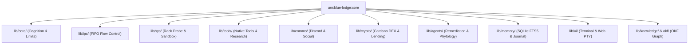

# Architecture Index & Component Directory

> Master reference for the Blue Lodge technical documentation. This index maps all repository components, source files, and design runbooks.

---

## 1. What Is Blue Lodge?

Blue Lodge is an autonomous, local-first sovereign agent workstation named **George**. Combining a robust, pure POSIX Bash-native core with a zero-latency Rust Axum web sidecar, an on-device CUDA PRISM inference fabric, a named-pipe IPC flow control engine, and a formal Google Open Knowledge Graph (OKF), Blue Lodge operates entirely on self-hosted hardware without mandatory external cloud dependencies.

- **Primary Targets**: Standard Linux workstations, WSL2, Proxmox VE hypervisors, Debian Crostini on ChromeOS, and Termux on Android (ARM Snapdragon).
- **Core Stacks**: Pure Bash (`lib/core`, `lib/ipc`, `lib/tools`), Rust (`web/`), Python 3 (`lib/sys/rack_probe.py`, `lib/tools/searxng_backend.py`, `lib/core/training_run.py`), and JavaScript/xterm.js (`web/static/`).

---

## 2. Recommended Reading Order

For engineers, operators, and agents exploring the architecture:

| # | Document | What You'll Learn |
|---|----------|-------------------|
| 1 | [[INDEX\|Master Documentation Index]] | The high-level Map of Content (MOC) connecting all 60+ documentation nodes in Obsidian. |
| 2 | [[ARCHITECTURE\|Sovereign Architecture Guide]] | System-level blueprint, container mappings, port allocations, and trust boundaries. |
| 3 | [[AGENT_LOOP\|Agent Loop & Task Execution]] | The two-loop system: honeydew milestone planning, ReAct reasoning, deliverable carry-forward, and wall-clock guards. |
| 4 | [[FIFO_ASYNC_IPC_FLOWCONTROL\|FIFO Async IPC Protocol]] | Non-blocking POSIX named pipes, sliding-window flow control, keeper processes, and atomic directory locks. |
| 5 | [[INSTRUMENT_RACK\|Instrument Rack & Fabric Topology]] | Real-time control/compute node topology probing, latency, slot occupancy, and the `/api/rack` REST API. |
| 6 | [[MODELS\|Model Workbench]] | Model-agnostic profile management, GGUF hardware fit analysis, approval gates, and serving presets. |
| 7 | [[DATASET_FORGE\|Dataset Forge]] & [[TRAINING_RUN_MANAGER\|Training Run Manager]] | Generating recipe-based SFT/DPO datasets from transcripts and managing multi-track distillation. |
| 8 | [[RESEARCH_VERIFIER\|Research Verifier & Grounding Gate]] | Gate 1 citation verification against the Phase-1 evidence ledger and Crossref fallback resolver. |
| 9 | [[DISCORD_BRIDGE\|Discord Bridge]] | Multi-turn in-channel delivery, message editing (`discord_edit`), outbox de-dup, and steering. |
| 10 | [[SOVEREIGN_DEX_AND_LENDING_GUIDE\|Sovereign DEX & Lending Guide]] | Cardano AMM flash-spread arbitrage, P2P loan underwriting, and Polymarket negative-risk arbitrage. |
| 11 | [[OKF_KNOWLEDGE_GRAPH\|Google OKF Knowledge Graph]] | Semantic JSON-LD schema, AST codebase discovery, and architectural standards catalog. |
| 12 | [[BASH_TECHNIQUES\|Bash Techniques Reference]] | Advanced shell patterns: namerefs, FIFOs, process substitution, traps, AWK state machines, and epoch math. |

---

## 3. High-Level Subsystem Directory

---

## 4. File-to-Subsystem Ground Truth Map

| File Path | Subsystem Domain | Primary Function | Primary Documentation |
| :--- | :--- | :--- | :--- |
| `lodge` | `ui` | Main executable, REPL CLI entrypoint, argument dispatcher | [[COMMAND_DISPATCH]] |
| `lib/core/react.sh` | `core` | Multi-turn ReAct reasoning loop, tool execution, carry-forward | [[AGENT_LOOP]] |
| `lib/core/context_engine.sh`| `core` | Adaptive context compression, working memory budgeting | [[AGENT_LOOP]], [[TUNING]] |
| `lib/core/reflexive.sh` | `core` | Metacognitive self-critique, soul gating, prompt advisors | [[REFLEXIVE]] |
| `lib/core/endpoints.sh` | `core` | Inference endpoint registry, multi-tier failover routing | [[INFERENCE_FABRIC]] |
| `lib/core/models.sh` | `core` | Model-agnostic profile sampling parameter lookup | [[MODELS]] |
| `lib/core/training_run.py` | `core` | Local/Colab multi-track training manager & GGUF fusion | [[TRAINING_RUN_MANAGER]] |
| `lib/core/limits.sh` | `core` | Resource governor, token limits, wall-clock ceiling | [[AGENT_LOOP]] |
| `lib/ipc/fifo_ipc.sh` | `ipc` | Non-blocking named pipe protocol v3, keeper channels | [[FIFO_ASYNC_IPC_FLOWCONTROL]] |
| `lib/ipc/task_sync.sh` | `ipc` | Inter-task synchronization, promise waiting, MQTT bridge | [[EVENT_BUS_AND_OSINT_PIPELINE]] |
| `lib/sys/rack_probe.py` | `sys` | Parallel compute node probe, slot monitor, topology analyzer | [[INSTRUMENT_RACK]] |
| `lib/sys/sandbox.sh` | `sys` | Ephemeral directory isolation, process namespace sandbox | [[SANDBOXES]] |
| `lib/sys/container.sh` | `sys` | Docker container supervisor and runtime executor | [[DOCKER_SANDBOX]] |
| `lib/sys/cron.sh` | `sys` | Background sweep scheduler and sentinel watchdog | [[CRON_AND_SCHEDULING]] |
| `lib/sys/vitals.sh` | `sys` | Hardware telemetry probe (GPU temp, VRAM, RAM, load) | [[VITALS]] |
| `lib/sys/secrets.sh` | `sys` | Encrypted secrets vault (AES-256-CBC, PGP key sealing) | [[SECRETS_VAULT]] |
| `lib/tools/native_tools.sh`| `tools`| Native POSIX tool catalog, schema generation for LLMs | [[AGENT_LOOP]], [[MCP]] |
| `lib/tools/searxng_backend.py`| `tools`| Local SearXNG metasearch client with engine scoring | [[SEARXNG_METASEARCH]] |
| `lib/tools/research_verifier.py`| `tools`| Gate 1 citation evidence grounding & Crossref validation | [[RESEARCH_VERIFIER]] |
| `lib/comms/discord_bridge.sh`| `comms`| Bidirectional Discord bot bridge, in-channel delivery | [[DISCORD_BRIDGE]] |
| `lib/comms/web.sh` | `comms`| Search router cascade (Cache -> SearXNG -> Brave -> DDG) | [[SEARXNG_METASEARCH]] |
| `lib/crypto/sovereign_fund.py`| `crypto`| Cardano treasury management, order watcher, yield ladder | [[SOVEREIGN_DEX_AND_LENDING_GUIDE]] |
| `lib/agents/phytology.sh` | `agents`| Living tissue self-healing engine, automated script repair | [[GITFLOW_ARCHITECTURE]] |
| `lib/agents/remediation.sh`| `agents`| Gitea issue intake, close-to-cancel, verification gate | [[OPERATOR_GITEA_INTAKE]] |
| `lib/memory/memory.sh` | `memory`| Working context buffer, facts ledger, system prompt builder | [[MEMORY_AND_RECALL]] |
| `lib/memory/recall.sh` | `memory`| SQLite FTS5 full-text search and BM25 ranking database | [[RECALL]], [[RECALL_INDEX]] |
| `lib/memory/journal.sh` | `memory`| Three-degree temporal decaying episodic memory journal | [[MEMORY_AND_RECALL]] |
| `lib/knowledge/okf.sh` | `knowledge`| Google OKF graph traversal, standards query, tree renderer | [[OKF_KNOWLEDGE_GRAPH]] |
| `web/src/main.rs` | `web` | Rust Axum web sidecar router, PTY runner, REST API | [[CRAFTSMAN_WORKBENCH]] |
| `web/src/rack.rs` | `web` | `/api/rack` topology probe handler and caching layer | [[INSTRUMENT_RACK]] |

---

## 5. Architectural Standards

All modifications must adhere to the 7 formal JSON-LD architectural standards in `okf/standards/`:
1. `fifo_async_ipc_protocol.jsonld` — Non-blocking named pipes and sliding-window flow control.
2. `rbac_and_uuid_linking_protocol.jsonld` — Role permissions and RFC 4122 UUID multi-entity linking.
3. `polyglot_runtime_standard.jsonld` — Polyglot guidelines (Bash, Python, Rust, JavaScript).
4. `subagent_sandbox_lifecycle.jsonld` — Git worktree sandboxing, orphan reaping.
5. `telemetry_closed_loop_remediation.jsonld` — Telemetry fingerprinting and automated remediation.
6. `okf_directory_standard.jsonld` — Repository layout and metadata standards.
7. `sovereign_inference_switching.jsonld` — Seamless inference switching between local production and research tiers.

---

## 6. Related Documentation
- [[INDEX|Master Documentation Index]] — Root Map of Content (MOC).
- [[ARCHITECTURE|Sovereign Architecture Guide]] — Detailed system overview.
- [[GEORGE_REFERENCE|George Quick Reference]] — Essential commands and runtime flags.
- [[OKF_KNOWLEDGE_GRAPH|Google OKF Knowledge Graph]] — Semantic graph architecture.
