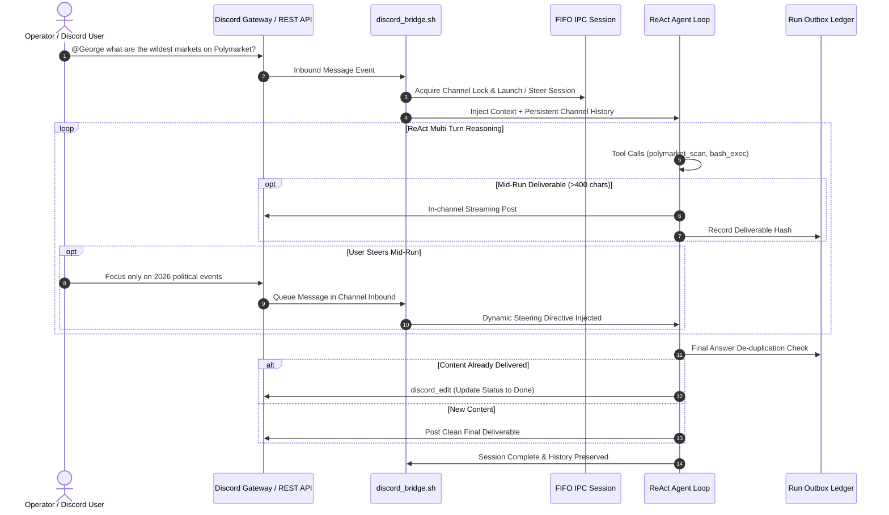

# Discord Bridge & Conversational Architecture

The **Blue Lodge Discord Bridge** connects George directly to Discord guilds and direct messages. It allows operators, team members, and community channels to interact with George in real time, leveraging native tool calling, deep research, and sovereign crypto workflows directly from Discord chat.



---

## 1. Conversational Behaviors & Guarantees

The Discord bridge enforces strict conversational integrity rules:

### A. Strict In-Channel Delivery
- All tool calls (`discord_send`, `discord_reply`) default to the **current active channel**.
- Target usernames never silently resolve to private DMs. Direct messaging requires an explicit `dm:<username_or_id>` prefix.
- All outbound messages are recorded to the per-run outbox ledger (`.george/discord_sessions/outbox_<run_id>.jsonl`).

### B. In-Flight Message Editing (`discord_edit`)
- George can edit his previous message in the active channel.
- Used for smooth progress updates (e.g., changing `"🔍 Scanning live order books..."` into the finalized analysis table) without spamming channel history.

### C. Final Deliverable De-duplication
- When long deliverables (>400 characters) are posted mid-run, George's final turn checks the outbox hash ledger.
- If the core answer was already delivered, the bridge skips redundant reposting and strips meta chatter (e.g., `"Action taken: I sent the message above"`).

### D. Persistent Channel Memory
- Unlike ephemeral terminal runs, Discord channel context persists across pipe sessions.
- Injected on **Turn 1** of every new interaction:
  - Channel name and ID.
  - Recent multi-speaker dialogue history (configurable TTL, default 2 hours; capped at 50 messages).
  - Pointers to recent files and dossiers generated in earlier runs.

### E. Concurrency & Mid-Run Steering
- **Single Session Lock**: Exactly one active George session runs per Discord channel at a time.
- If another user or the operator posts in the channel while George is executing:
  - The message is **not** discarded.
  - It is **not** spawned as a conflicting parallel run.
  - It is parsed from the inbound queue and injected as a **live steering prompt** into the next turn of the active ReAct loop.

### F. Interrupted Run Resilience
- If `george-web` restarts or a hardware error occurs while a Discord run is executing:
  - The channel keeper process catches the abnormal exit.
  - An honest, clear notification is posted to the channel:
    > `⚠️ [Blue Lodge Notice] My execution run was interrupted by an engine restart. Please re-issue your prompt if you need me to continue.`

---

## 2. Configuration & Secrets

Discord credentials are configured in `.george/secrets.env` (permissions `0600`):

```bash
# Discord Bot Credentials
DISCORD_BOT_TOKEN="MTI5OD..."
DISCORD_CLIENT_ID="1298..."
DISCORD_GUILD_ID="1150..."

# Permitted Channels (comma-separated IDs, or * for all accessible channels)
DISCORD_ALLOWED_CHANNELS="115082728192837264,115082987162817291"

# Conversational Limits
DISCORD_HISTORY_TTL_SEC=7200
DISCORD_HISTORY_MAX_MSGS=50
DISCORD_MAX_OUTPUT_CHARS=1900
```

### Starting the Bridge
The Discord bridge can run as an autonomic background service or via slash command:
```bash
# Start the bridge daemon
lodge /discord start

# Check bridge status, active sessions, and websocket heartbeat
lodge /discord status

# Inspect outbox ledger
lodge /discord outbox
```

---

## 3. Tool Calling in Discord

When chatting with George in Discord, the full suite of Blue Lodge tools is available based on the operator's configured permissions:
- **Web & Research**: `/searxng`, `arxiv_search`, `web_fetch`.
- **Crypto & DEX**: `cardano_dex_swap`, `cardano_p2p_underwrite`, `polymarket_scan`.
- **System**: `vitals_check`, `rack_probe`, `git_status`.

All tool outputs are sanitized to avoid markdown rendering collisions and clipped at 1,900 characters per message to respect Discord's 2,000 character limit.

---

## 4. Related Documentation
- [[SOCIAL_BOTS|Social Bots & API Setup Guide]] — Multi-platform social integrations (X, Mastodon, Telegram).
- [[AGENT_LOOP|Agent Loop & ReAct Reasoning]] — Turn limits, honeydew milestones, and carry-forward.
- [[EVENT_BUS_AND_OSINT_PIPELINE|Event Bus & OSINT Pipeline]] — Ingesting event triggers and automated alerts.
- [[FIFO_ASYNC_IPC_FLOWCONTROL|FIFO Async IPC Flow Control]] — Inter-process communication and keeper channels.
- [[SAFETY_AND_PRIVACY|Safety & Privacy Framework]] — Operator feature flags and privacy controls.
