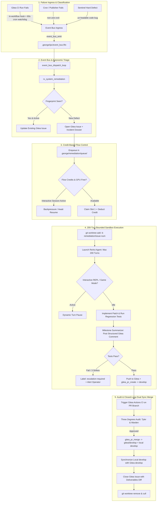

# 🏗️ Sovereign Autonomic GitFlow Remediation Architecture

## 1. Architectural Flowchart

```mermaid
gantt
    title Autonomic GitFlow Remediation Engine Implementation
    dateFormat  X
    axisFormat %s
    section Phase 1
    Sentinel Triage & ReAct Sandbox Alignment       :p1, 0, 1
    section Phase 2
    Event Bus Failure Ingress & Hybrid CI Watchdog :p2, 1, 2
    section Phase 3
    IPC FIFO Priority Scheduling & Mid-Loop Yield  :p3, 2, 3
    section Phase 4
    Task Bay Card & Milestone Gitea Summarizer     :p4, 3, 4
    section Phase 5
    Dual-Sync GitFlow PR Lifecycle & End-to-End Test:p5, 4, 5
```

---

## 2. Core Architectural Pillars

### Pillar I: Sentinel Separation of Concerns
- **`sentinel_housekeeping`**:
  - Silently prunes finished/aged sandboxes (`research_*`, `session_*`, `cron_*`), stale lock files, and dead PID registrations.
  - Zero alerts, zero Gitea issues, zero noisy popups.
  - Fixes directory divergence bug between `.george/workspaces/` and `.sandboxes/` so clean runs are never flagged as dead orphans.
- **`sentinel_escalation`**:
  - Triggers **only** on un-healable system faults (crashing background daemons, repeat bash syntax errors, corrupted state).
  - Emits `system.daemon_crash` or `system.syntax_fault` into `event_bus.fifo`.

### Pillar II: Event Bus Failure Ingress & Deduping
- **Sources**:
  - **Cron / Publishers**: In `lib/sys/cron.sh`, any non-zero exit emits `system.job_failure`.
  - **Gitea Actions CI**: Hybrid approach combining an in-workflow `if: failure()` step in `.gitea/workflows/ci.yml` and a 60-second fallback watchdog in `cron.sh`.
- **Reactor (`rx_system_remediation`)**:
  - Subscribes to `system.*_failure` and `ci.build_failure`.
  - Computes a deterministic 12-char SHA256 error fingerprint via `telemetry_fingerprint`.
  - If an issue with that fingerprint is already active, appends a recurrence timestamp and telemetry trace instead of spamming duplicate issues.
  - If new, creates an open tracking issue on sovereign Gitea with full incident artifacts.

### Pillar III: Dynamic Turn-Level Yielding & IPC Flow Control
- **Priority Scheduling**:
  - Introduces channel priority parameter in `lib/ipc/fifo_ipc.sh`:
    `INTERACTIVE (100) > CRITICAL_SYSTEM (80) > CRON (50) > REMEDIATION (20)`
- **Dynamic Yielding**:
  - Checked before **every** reasoning turn in the 200-turn loop.
  - Instantly enters an asynchronous blocking pause if Slot 0 inference is active, a REPL prompt is received, Discord chat is active, or `.george/.game_mode` is enabled.
  - Wakes automatically and resumes the exact reasoning state as soon as interactive compute returns to idle.

### Pillar IV: Task Bay HUD Visual Card & Summarized Gitea Comments
- **Dedicated Task Bay Card**:
  - High-visibility monitoring card with colored status indicators (Turn count, Flow state, Test status).
  - Companion live monitor streaming cleanly formatted phase progression.
- **Milestone Summarization**:
  - Instead of dumping raw multi-thousand token reasoning traces, the agent summarizes progress at major checkpoints:
    1. *Diagnostic Phase*: Root cause hypothesis & error reproduction trace.
    2. *Staging Phase*: Files modified, architecture compliance check.
    3. *Validation Phase*: Test suite pass/fail results & coverage.
    4. *Delivery Phase*: PR opened with rich diffstat and verification evidence.

### Pillar V: GitFlow Closed-Loop Dual Sync Merge
- **Execution Sandbox**:
  - Worktree provisioned at `.sandboxes/remediation_<task_id>` on branch `remediation/<task_id>`.
  - Pure POSIX constraint enforced (zero dirty host dependencies).
- **Dual Branch Synchronization**:
  - After Gitea Actions CI passes on the PR branch and the Three Degrees Audit (Tyler & Warden) clears the change:
    - PR merged into sovereign Gitea `develop` via `gitea_pr_merge`.
    - Local `develop` pulled/merged to stay in 1:1 bitwise synchronization with Gitea `develop`.
    - Upstream `origin` (GitHub) remains strictly protected and untouched.
- **Circuit Breaker**:
  - Maximum 3 attempts per fingerprint before permanent operator escalation (`escalation-required` label + Discord alert).
  - Failed branches are preserved on Gitea for human inspection while ephemeral local worktrees are cleanly culled.