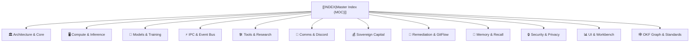

# Blue Lodge Sovereign Wiki — Master Index & Map of Content

Welcome to the **Blue Lodge Sovereign Documentation Wiki**. This repository is engineered as an interconnected, bidirectional knowledge graph optimized for viewing and navigation in **[Obsidian](https://obsidian.md)**, as well as programmatic traversal via the **Google Open Knowledge Graph (OKF)** engine.

---

## 🏛️ 1. Architecture, Standards & Operating Principles
Foundational architecture, design philosophy, environment configuration, and execution guidelines.

- [[ARCHITECTURE|Blue Lodge Sovereign Architecture Guide]] — System overview, specialist agent roles, and execution pipelines.
- [[ARCHITECTURE_INDEX|Architecture Index]] — Complete directory of repository files, services, and modules.
- [[GEORGE_REFERENCE|George Quick Reference]] — Essential commands, configuration flags, and operational cheatsheet.
- [[MORAL_SENTIMENTS|The Theory of Moral Sentiments]] — Ethical foundation, soul principles, and self-restraint directives.
- [[ENVIRONMENT_VARIABLES|Environment Variables Reference]] — Exhaustive library of environment flags, defaults, and overrides.
- [[BASH_TECHNIQUES|Bash Techniques Reference]] — POSIX scripting patterns, strict error traps, and performance optimizations.
- [[OKF_KNOWLEDGE_GRAPH|Google Open Knowledge Graph (OKF) Guide]] — JSON-LD semantic architecture, AST scanning, and standards catalog.

---

## 🧠 2. Core Agent Loop & Reasoning Engine
The autonomous cognition engine, multi-turn reasoning loops, context compressors, and token budgeting.

- [[AGENT_LOOP|Agent Loop & Task Execution]] — Strategist/executor architecture, honeydew milestones, deliverable carry-forward, and wall-clock guards.
- [[REFLEXIVE|Reflexive Intelligence]] — Metacognitive self-critique, soul gating, and prompt perturbation advisors.
- [[RESPONSE_PARSING|Response Parsing Engine]] — Grammar-constrained outputs, JSON extraction, and tool call handling.
- [[LLM_CALL_MAPS|LLM Call Maps]] — Sequence diagrams for prompt composition, streaming, and tool execution.
- [[STREAMING_PIPELINE|Streaming Pipeline Architecture]] — Real-time token streaming and terminal visualizer.
- [[TUNING|Token & Context Tuning Guide]] — Dynamic context management, attention budgeting, and token limits.

---

## 🖥️ 3. Inference Fabric & Instrument Rack
Hardware monitoring, dual-GPU PRISM topology, remote Proxmox nodes, and failover cascades.

- [[INSTRUMENT_RACK|Instrument Rack & Fabric Topology]] — Real-time control/compute node probe, slot utilization, latency, and `/api/rack` API.
- [[INFERENCE_FABRIC|Inference Fabric Guide]] — Multi-tier remote GPU clusters, SSH tunnels, and load balancing.
- [[BACKEND_VALIDATION|Backend Validation Guide]] — Validating endpoint health, OpenAI compatibility, and streaming latency.
- [[PROXMOX_GPU_SETUP|Proxmox GPU Passthrough]] — Provisioning dedicated inference nodes with GPU passthrough.
- [[ADRENO_GPU_SETUP|Adreno GPU Setup]] — Running local llama.cpp on Android/Termux using Vulkan shaders.

---

## 🤖 4. Model Workbench, Dataset Forge & Training
Local model library management, continuous learning, and multi-track fine-tuning pipelines.

- [[MODELS|Model Workbench]] — Local GGUF catalog, hardware fit tables, draft/approve/activate lifecycle, and model copilot.
- [[DATASET_FORGE|Dataset Forge]] — Creating recipe-based SFT and DPO datasets from real agent homework and transcripts.
- [[TRAINING_RUN_MANAGER|Training Run Manager]] — Multi-track local and cloud (Google Colab) distillation, checkpoint fusion, and benchmark guards.
- [[BLUE_LODGE_LORA_TUNING_PLAYBOOK|LoRA Fine-Tuning Playbook]] — QLoRA hyperparameters, loss convergence, and rank selection.
- [[BLUE_LODGE_MODEL_EXPANSION_PLAYBOOK|Model Expansion Playbook]] — Continuous domain adaptation and knowledge expansion.
- [[SOVEREIGN_FOUNDATION_MODEL_PLAYBOOK|Sovereign Foundation Model Playbook]] — Distillation, structured post-training quantization, and GRPO alignment.
- [[NEURIPS_2026_BLUE_LLAMA_CHAMPION_V5|Champion-v5 Research Architecture]] — Hybrid SSM-Attention macroblock distillation specification.
- [[QWEN38_FRONTIER_RESEARCH_AGENDA|Qwen 3.8 Research Agenda]] — Frontier agentic experimentation and evaluation goals.
- [[SUB_158B_QUANTIZATION_RESEARCH_PLAN|Sub-1.58b Quantization Plan]] — Extreme ternary weight quantization research.

---

## ⚡ 5. Asynchronous FIFO IPC & Event Bus
Kernel-backed inter-process communication, named pipe flow control, and event-driven automation.

- [[FIFO_ASYNC_IPC_FLOWCONTROL|POSIX FIFO Async IPC Protocol]] — Non-blocking named pipes (`data.fifo`, `ctrl.fifo`), sliding-window credit flow control, and AWK garbage collection.
- [[EVENT_BUS_AND_OSINT_PIPELINE|Reactive Event Bus & OSINT Pipeline]] — Autonomous event listeners, OSINT watchers, and alerting triggers.
- [[SDR_LAB_OPERATOR_AND_USER_GUIDE|Sovereign P25 SDR Radio Lab — Operator & User Guide]] — Containerized deployment (`remote_ssh`, `local_dir`, `shared_local`, `ipc_bus`, `standalone`), 5-part `trunk-recorder` 5.2.0 P25 CQPSK/LSM DSP patch, A100 LoRA training, and storage retention.
- [[MQTT|MQTT Integration]] — Mosquitto message broker setup for lightweight IoT and external event dispatch.

---

## 🛠️ 6. Tools, MCP, Search & Research Verifier
Tool execution sandbox, Model Context Protocol integration, and scientific literature verification.

- [[MCP|Model Context Protocol Guide]] — Pure-Bash JSON-RPC client and built-in server suite.
- [[SEARXNG_METASEARCH|SearXNG Sovereign Metasearch]] — Local keyless aggregate search across 70+ engines, MCP server, and circuit breakers.
- [[RESEARCH_VERIFIER|Research Verifier & Grounding Gate]] — Gate 1 citation verification, Phase-1 evidence ledger, Crossref fallback, and quarantine notices.
- [[LRU_CACHE|LRU Cache Reference]] — High-performance filesystem and memory deduplication cache.
- [[GYM|George Gym & Validation Workouts]] — Golden-task evaluation suites and RLHF alignment benchmarks.

---

## 💬 7. External Communications & Discord Bridge
Bidirectional chat bridges, notification dispatchers, and mobile client connectivity.

- [[DISCORD_BRIDGE|Discord Bridge & Conversational Architecture]] — In-channel delivery, message editing (`discord_edit`), persistent channel memory, mid-run steering, and crash notices.
- [[SOCIAL_BOTS|Social Bots & API Setup]] — Multi-platform integrations for Mastodon, Twitter/X, Telegram, and Bluesky.
- [[EMAIL_GITHUB|Email & GitHub Integration]] — IMAP/SMTP mail polling and GitHub repository operations.
- [[PHONE_INTEGRATION|Phone Integration]] — Telephony and SMS alerts via Twilio and Termux APIs.
- [[PHONE_SETUP|Android & Termux Phone Setup]] — Complete installation walkthrough for running Blue Lodge on mobile hardware.
- [[IOS_MACOS_SETUP|iOS & macOS Setup Guide]] — Remote pairing and client configuration for Apple ecosystems.
- [[DEBIAN_CHROMEOS_SETUP|Debian & ChromeOS Setup Guide]] — Running Blue Lodge inside ChromeOS Linux containers (Crostini).

---

## 💰 8. Sovereign Capital, DEX & Lending Engine
Decentralized finance operations, automated market maker integration, and P2P credit underwriting.

- [[SOVEREIGN_DEX_AND_LENDING_GUIDE|Sovereign DEX & Lending Guide]] — Comprehensive manual for Cardano DEX arbitrage, P2P lending underwriting, Polymarket negative-risk arbitrage, and maker corridors.
- [[CRYPTO_WALLETS|Crypto Wallets & Hot Wallet Guide]] — Cardanos CLI / Ogmios / Kupo setup, balance monitoring, and key security.

---

## 🧬 9. Living Tissue, Phytology & Autonomic Remediation
Self-healing code tissue, automated triage, and closed-loop continuous integration.

- [[GITFLOW_ARCHITECTURE|Autonomic GitFlow Remediation]] — Self-healing branch management and pull request generation.
- [[OPERATOR_GITEA_INTAKE|Operator Gitea Intake & Remediation]] — Issue triage, staged incident evidence, close-to-cancel lifecycle, and the Real Verification Gate.
- [[CRON_AND_SCHEDULING|Autonomic Cron & Scheduling Engine]] — Periodic daemon sweeps, log rotation, and sentinel stall detectors.
- [[VITALS|System Vitals]] — Hardware telemetry, GPU wattage/temperature sensors, and memory trackers.

---

## 💾 10. Memory, SQLite FTS5 Recall & Journal
Multi-tier persistence, decaying episodic recall, and project trajectories.

- [[MEMORY_AND_RECALL|Memory, Recall & Journal Guide]] — Macro/micro memory stores, context retention, and working memory.
- [[RECALL|Recall — SQLite FTS5 Knowledge Base]] — Full-text search engine indexing code symbols, past milestones, and transcripts.
- [[RECALL_INDEX|George Recall Index]] — Database schema, BM25 ranking parameters, and query optimization.

---

## 🔒 11. Security, Sandboxes, Privacy & PGP
Trust boundaries, process sandboxing, credential encryption, and cryptographic auditability.

- [[SECURITY_AND_SECRETS|Security & Secrets Architecture]] — Threat model, defense-in-depth, and attack surface minimization.
- [[SAFETY_AND_PRIVACY|Safety, Feature Flags & Privacy Framework]] — Operator feature flags (`data/feature_flags.json`), live-sell protection, and the `/forget` privacy scrub protocol.
- [[SECRETS_VAULT|Secrets Vault]] — Encrypted key store and automated `.env` synchronization.
- [[REMOTE_ACCESS_SECURITY|Remote Access Security]] — Device pairing tokens, cryptographic authentication, and session management.
- [[SANDBOXES|Sandboxes Guide]] — User namespace, chroot, and proot isolation.
- [[DOCKER_SANDBOX|Docker Sandbox]] — GPU-accelerated container isolation for agent-run bash commands.
- [[AGENTIC_CONTAINER_SYSTEM_DESIGN|Agentic Container System Design]] — Architectural specification for containerized subagent runtimes.
- [[PGP_SIGNING|PGP Signing Guide]] — GnuPG verification and signing of autonomous dossiers and journals.
- [[USER_PERMISSIONING_AND_UUID_LINKING|User Permissioning & UUID Linking]] — RFC 4122 UUID multi-entity graph linking and RBAC policies.

---

## 📊 12. UI, Terminal & Sovereign Web Workbench
Terminal styling, ANSI mascots, real-time dashboards, and the Rust web sidecar.

- [[UI_AND_TERMINAL|UI & Terminal Rendering]] — ANSI mascot banners, dynamic progress spinners, and status tables.
- [[CRAFTSMAN_WORKBENCH|Craftsman Workbench]] — Web UI navigation, xterm.js PTY, Model Workbench modal, and live instrument panels.
- [[SLASH_COMMANDS|Slash Commands Architecture]] — Slash command dispatch catalog and parameter routing.
- [[SLASH_EXTENSIONS|Slash Extensions]] — Developing and mounting custom user-defined slash commands.

---

## ☁️ 13. Cloud Providers & APIs
Connecting external inference endpoints as secondary fallbacks.

- [[PROVIDERS|Cloud AI Providers Setup]] — Setup, pricing, and latency comparison for Google AI Studio, Groq, Mistral, Anthropic, and OpenAI.
- [[API_AND_PROVIDERS|API Layer & Cloud Providers]] — HTTP request abstractions, curl streaming, and fallback cascades.

---

## 📚 14. Examples & Walkthroughs
Step-by-step practical guides demonstrating Blue Lodge capabilities.

- [[examples/personal-assistant|Personal Phone Assistant]] — Configuring Blue Lodge as an autonomous mobile companion.
- [[examples/rust-task-manager|Building a Rust CLI Task Manager]] — Autonomous feature planning, TDD, and implementation.
- [[examples/url-shortener|Building a URL Shortener API (Python)]] — Full-stack scaffolding, testing, and documentation.
- [[archive/old_soul|Historical Archive: Soul of George]] — Original soul documentation preserved for posterity.

---

## 🧭 How to Use this Vault in Obsidian

1. **Open Vault**: In Obsidian, select **"Open folder as vault"** and choose `/opt/blue-lodge/docs`.
2. **Graph View**: Press `Ctrl+G` to open the interactive **Graph View**. Every subsystem and document links into central hubs like `[[INDEX]]`, `[[ARCHITECTURE]]`, and `[[MODELS]]`.
3. **Backlinks & Hover Preview**: Hover over any `[[Link]]` to view a live preview of the target document without leaving your active note.
4. **Tags**: Explore topics via Obsidian's tag browser (`#sovereign`, `#inference-fabric`, `#training`, `#discord`, `#crypto`, etc.).
5. **OKF Synchronization**: When documentation or code changes occur, run `okf sync` to regenerate the formal knowledge graph (`okf/blue_lodge_graph.jsonld`).
