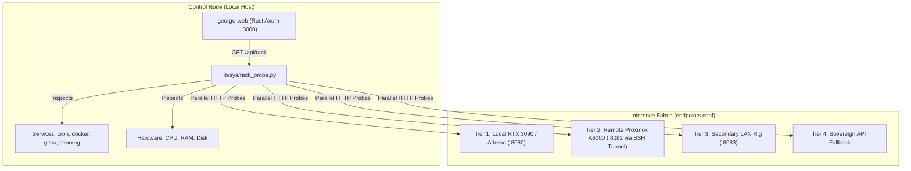

# Instrument Rack & Fabric Topology Guide

The **Instrument Rack** is Blue Lodge's unified operational diagnostic panel and real-time topology probe. It provides continuous visibility into the hybrid inference fabric—from the local host (control node) across remote Proxmox nodes, SSH tunnels, LAN GPUs, and cloud fallback endpoints.



---

## 1. Core Architecture

The Instrument Rack separates **control state** from **compute availability**:
1. **Control Node**:
   - Host identity (hostname, OS, kernel, uptime).
   - Core daemon health (`george-web`, `cron`, `searxng`, `gitea`, `mosquitto`).
   - Host vitals (load average, memory usage, root disk space).
2. **Compute Nodes (`endpoints.conf`)**:
   - Multi-tier endpoints queried in parallel with non-blocking timeouts (1.5s max).
   - Real-time slot utilization (`active_slots / total_slots`).
   - Active served model name and context window size (`n_ctx`).
   - Network path identification: `LOCAL` (unix domain socket / 127.0.0.1:8080), `SSH_TUNNEL` (tunneled port), `LAN` (private subnet), or `WAN/CLOUD`.
   - Latency measurements with millisecond precision.
3. **Role Coverage Matrix**:
   - Determines whether the current fabric satisfies operational roles:
     - `Fast Coder`: Model >= 14B, latency < 100ms.
     - `Deep Reasoner`: Model >= 32B or context >= 32,768 tokens.
     - `High-Throughput Swarm`: Total available slots >= 4 across nodes.
     - `Local Sovereign Fallback`: Zero-internet offline survivability.
4. **Automated Findings & Warnings**:
   - Detects offline nodes, slot starvation, high latency (>500ms), and misconfigured context windows.

---

## 2. The Rack Probe Engine (`lib/sys/rack_probe.py`)

The probe is a zero-dependency, pure Python 3 script adhering strictly to POSIX security practices.

### Invocation
```bash
# Run standalone CLI probe (formatted JSON)
python3 lib/sys/rack_probe.py

# Run via slash command
lodge /backend rack

# Query the REST API
curl -s http://127.0.0.1:3000/api/rack | jq .
```

### JSON Output Schema
```json
{
  "generated_at": 1791165836,
  "control": {
    "host": "sovereign-rig",
    "cpus": 24,
    "memory": {
      "total_mb": 64120,
      "used_mb": 14200,
      "free_mb": 49920,
      "percent": 22.1
    },
    "disk": {
      "free_gb": 712.5,
      "total_gb": 1024.0,
      "used_percent": 30.5
    },
    "containers": [
      { "name": "george-gitea", "status": "Up 5 hours" },
      { "name": "george-prism-server", "status": "Up 10 hours" },
      { "name": "george-searxng", "status": "Up 6 hours" },
      { "name": "george-mosquitto", "status": "Up 10 hours" },
      { "name": "george-act-runner", "status": "Up 10 hours" }
    ]
  },
  "nodes": [
    {
      "tier": 1,
      "name": "cuda-dual-rtx3060-frontier",
      "url": "http://127.0.0.1:8080",
      "state": "healthy",
      "latency_ms": 25,
      "live_model": "Qwen3.8-27B-UD-Q4_K_S",
      "context_window": 32768,
      "slots": { "active": 0, "total": 4 }
    }
  ],
  "roles": [
    { "role": "architecture", "nodes": ["cuda-dual-rtx3060-frontier"], "online": ["cuda-dual-rtx3060-frontier"] },
    { "role": "coding", "nodes": ["cuda-dual-rtx3060-frontier"], "online": ["cuda-dual-rtx3060-frontier"] },
    { "role": "offgrid_fallback", "nodes": ["edge-mobile"], "online": [] }
  ],
  "findings": []
}
```

---

## 3. Web Workbench Integration (`/api/rack`)

The Rust Axum web sidecar exposes `/api/rack`:
- **Caching**: 15-second TTL cache prevents probe storms during high-frequency dashboard polling.
- **Safety**: Probe executions use `std::process::Command` with explicit `argv` slices, bypassing shell interpretation.
- **Dynamic DOM Rendering**: The Instrument Rack tab in `web/static/app.js` renders real-time SVG status badges, hardware meters, and interactive slot gauges.

---

## 4. Node Configuration & Safety Gate

Nodes are managed in `config/endpoints.conf`. When updated via the web UI or CLI:
- URLs must start with `http://` or `https://` (no file://, gopher://, or command injection).
- Ports must be numeric in range 1-65535.
- Hostnames must match valid RFC 1123 domain syntax or IP addresses.
- SSH jump hosts must use valid configured SSH alias identifiers.

---

## 5. Related Documentation
- [[INFERENCE_FABRIC|Inference Fabric Guide]] — Remote GPU tier setup and multi-node clustering.
- [[MODELS|Model Workbench]] — Local GGUF catalog, profile drafting, and activation.
- [[VITALS|System Vitals]] — Low-level GPU hardware sensors and metric collection.
- [[BACKEND_VALIDATION|Backend Validation Guide]] — Validating endpoint responses and token streaming.
- [[CRAFTSMAN_WORKBENCH|Craftsman Workbench]] — Web UI navigation and operator controls.
