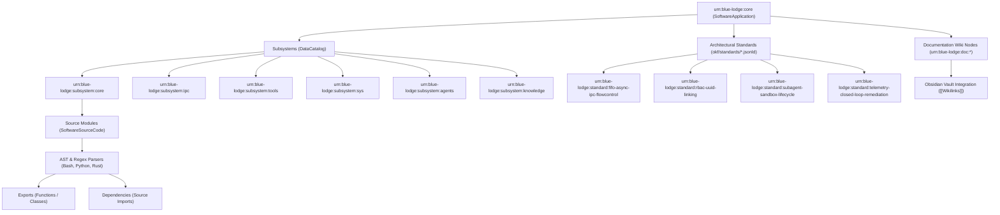

# Google Open Knowledge Graph (OKF) & Standards Guide

Blue Lodge models its entire architecture—every subsystem, source module, public function export, dependency link, architectural standard, and documentation note—as a formal **Google Open Knowledge Graph (OKF)** JSON-LD graph. This graph lives at `okf/blue_lodge_graph.jsonld` (symlinked as `okf.jsonld`) and powers semantic codebase navigation for both human craftsmen and autonomous agents.



---

## 1. Graph Structure & JSON-LD Vocabulary

The graph conforms to Schema.org and Google Knowledge Graph standards:
- **`@context`**:
  ```json
  {
    "@vocab": "https://schema.org/",
    "goog": "http://schema.googleapis.com/",
    "okf": "https://developers.google.com/knowledge-graph/schema/",
    "lodge": "urn:blue-lodge:schema:"
  }
  ```
- **Node Types**:
  - `SoftwareApplication`: Root entity representing Blue Lodge.
  - `DataCatalog`: Subsystem domains (`lib/core`, `lib/ipc`, `lib/tools`, etc.).
  - `SoftwareSourceCode`: Individual source files with programming language, description, exported symbols, and dependent modules.
  - `DigitalDocument`: Documentation guides in `docs/` linked via bidirectional wikilinks.
  - `Standard`: Architectural protocols defined in `okf/standards/*.jsonld`.

---

## 2. Dynamic AST Codebase Scanner (`okf/generate_okf_graph.py`)

The graph generator parses the workspace in real time:
1. **Python**: Uses `ast.parse()` to extract top-level class definitions, async/sync function signatures, module docstrings, and import dependencies.
2. **Bash**: Structural regex scanner parses function definitions, exported SDK symbols (`_ipc_*`, `_okf_*`), and `source` / `.` dependency paths.
3. **Rust**: Regex extractor identifies `pub async fn` and doc comments across `web/src/`.
4. **Docs**: Scans YAML frontmatter (`title`, `subsystem`, `tags`, `okf_id`, `related`) and parses Obsidian `[[...]]` wikilinks to construct an interrelated documentation graph.

---

## 3. CLI Operations (`bin/okf`, `lib/knowledge/okf.sh`)

Blue Lodge provides a dedicated binary and slash command for interacting with the knowledge graph:

```bash
# Search modules, functions, or standards by semantic query
okf search "sliding window flow control"
lodge /okf search "cardano p2p"

# Query exact node details (exports, dependencies, path)
okf query urn:blue-lodge:module:lib/ipc/fifo_ipc.sh
lodge /okf query fifo_ipc.sh

# List all architectural standards or inspect a specific standard
okf standards
okf standards urn:blue-lodge:standard:fifo-async-ipc-flowcontrol

# Render ASCII architectural hierarchy tree
okf tree

# Validate graph against JSON Schema
okf validate

# Regenerate and synchronize graph after code changes
okf sync
```

---

## 4. Architectural Standards Catalog (`okf/standards/`)

Blue Lodge maintains 7 strict architectural standards:

1. **`fifo_async_ipc_protocol.jsonld`**: Zero-daemon named pipe protocol, sliding-window flow control, atomic locking.
2. **`rbac_and_uuid_linking_protocol.jsonld`**: Capability-based role permissions and RFC 4122 UUID multi-entity linking.
3. **`polyglot_runtime_standard.jsonld`**: Rules for polyglot interoperability (Bash, Python, Rust, JavaScript).
4. **`subagent_sandbox_lifecycle.jsonld`**: Git worktree subagent isolation, reaper loops, and orphan prevention.
5. **`telemetry_closed_loop_remediation.jsonld`**: Error fingerprinting, incident preservation, and automated remediation.
6. **`okf_directory_standard.jsonld`**: Structural layout requirements for OKF graph storage and schemas.
7. **`sovereign_inference_switching.jsonld`**: Dual-profile switching between local production and research inference tiers.

---

## 5. Obsidian Vault Integration

The documentation in `docs/` is designed to be opened directly as an **Obsidian Vault**:
- **Bidirectional Links**: Internal documentation links use standard Obsidian `[[DocName]]` syntax, enabling Obsidian's interactive Graph View, Backlinks Panel, and Canvas.
- **YAML Frontmatter**: Standard metadata properties render clean tags and attributes in Obsidian's properties pane.
- **Root Map of Content**: [[INDEX|docs/INDEX.md]] serves as the central jumping-off point for all navigation.

---

## 6. Related Documentation
- [[INDEX|Master Documentation Index]] — Root navigation hub for the Obsidian vault.
- [[ARCHITECTURE|Blue Lodge Architecture]] — Overall system design.
- [[ARCHITECTURE_INDEX|Architecture Index]] — File and module reference catalog.
- [[BASH_TECHNIQUES|Bash Techniques Reference]] — Core implementation patterns.
- [[SLASH_COMMANDS|Slash Commands Reference]] — CLI command definitions.
