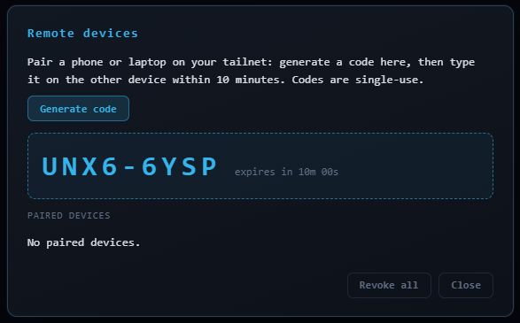
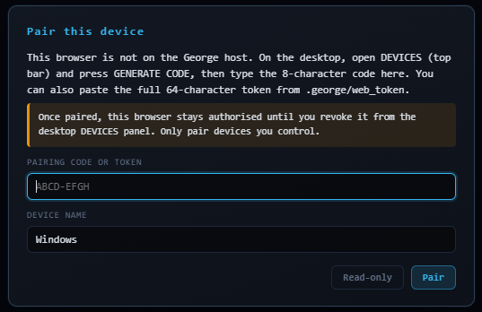
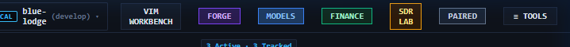
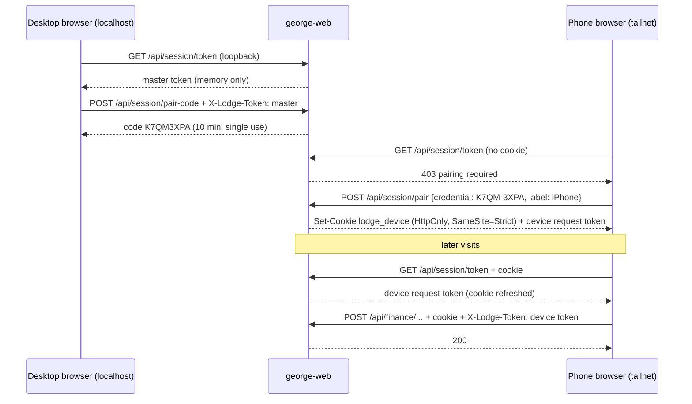
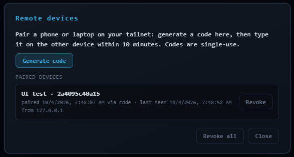

# Remote Access Security — george-web

> How the web workbench (`http://<host>:3000`) protects wallet and trading actions
> when you open it from another device.
>
> **Code:** [`web/src/security.rs`](../web/src/security.rs) ·
> [`web/src/devices.rs`](../web/src/devices.rs) ·
> [`web/static/js/session.js`](../web/static/js/session.js) ·
> [`bin/lodge-web-auth`](../bin/lodge-web-auth)

---

## 1. Quick start: pair your phone (one time)

1. **On the desktop** (the George host, browsing `http://localhost:3000`), click
   **DEVICES** in the top bar, then **Generate code**. An 8-character code such as `K7QM-3XPA`
   appears. It is valid for **10 minutes** and works **once**.
   - From a terminal instead: `bin/lodge-web-auth pair-code`

   

2. **On the phone**, open `http://<host-tailnet-name-or-100.x.y.z>:3000`. The **Pair this device**
   dialog appears. Type the code, check the device name, and tap **Pair**.

   

3. Done. The phone now stays authorised **until you revoke it**. Reloads, browser restarts and phone
   reboots do not require the code again. The header button changes from DEVICES to **PAIRED**.

   

> [!TIP]
> No desktop browser nearby? Paste the full 64-character key from `.george/web_token` into the same
> dialog instead of a code. The result is the same: the device is paired and remembered.

**Read-only** in the dialog skips pairing for this visit. Dashboards and GET routes still work.
Wallet and trading actions stay disabled.

---

## 2. What is protected, and how

### 2.1 Credentials

| Credential | Where it lives | Who gets it | What it unlocks |
|---|---|---|---|
| **Master token** (the "API key") | `.george/web_token`. 64 hex chars (256 bits from `/dev/urandom`), file mode `0600` | The browser on the host itself (via `/api/session/token`, localhost only), and anyone who can read the file | Everything guarded, including minting pairing codes and managing devices |
| **Pairing code** | Server memory only | Shown on the desktop / CLI | One pairing, within 10 min. Single use. Max 3 outstanding |
| **Device cookie** `lodge_device` (or `__Host-lodge_device` over HTTPS) | Phone browser cookie jar. `HttpOnly`, `SameSite=Strict`, `Path=/`, 400-day Max-Age, refreshed on every visit | The paired browser | Identifies the device. JavaScript cannot read it |
| **Device request token** | Server registry, and page memory | The paired browser's page, via `/api/session/token` | Sent as `X-Lodge-Token` on guarded calls. Useless without the matching cookie |

Device records are stored in `.george/web_devices.json` (mode `0600`). Each record has an id,
label, the two secrets, created/last-seen times, last IP and how it was paired (`code` or `token`).

### 2.2 Which routes need a credential

| Route | Requirement |
|---|---|
| `/api/wallet/*` (all methods, including reads such as the keystore listing) | Master token **or** paired device (cookie + request token) |
| `/api/finance/*` with POST/PUT/DELETE (orders, sends, loans, ledger, …) | Same as above |
| `/api/finance/*` GET (dashboards, prices, odds) | None |
| `/api/session/pair-code`, `/api/session/devices`, `/api/session/devices/revoke` | **Master token only.** A paired phone cannot mint new pairings or revoke others |
| `/api/session/pair` | A valid pairing code or the master token in the body. Rate-limited |
| `/api/session/forget` | The device's own cookie + request token |
| Everything else (chat, tasks, terminal, files, …) | **None — see the warning below** |

> [!WARNING]
> **Non-financial routes are not authenticated.** Chat, task control, file routes and the
> interactive **terminal WebSocket** (`/api/terminal/ws`) answer anyone who can reach port 3000.
> The server binds `0.0.0.0`. On a home LAN plus a private tailnet that is a deliberate convenience
> trade-off (`TODO(security)` in `security.rs`). Treat **network reachability as the real perimeter**:
> - Do not port-forward 3000 on your router or expose it through a public tunnel.
> - Keep headscale ACLs tight (see §5).
> - If you want the device pairing to gate *everything* for non-local clients, ask for it. The
>   pairing machinery now makes that a small change.

### 2.3 Layered defences

1. **Origin guard** (every request). Requests are rejected when the browser marks them
   `Sec-Fetch-Site: cross-site`, when `Origin: null`, or when the `Origin` does not match `Host`.
   This blocks malicious websites from driving the API or the WebSocket from your browser.
2. **Token guard** (wallet and finance writes). Accepts the master token, or a device request token
   **together with** that device's cookie. Comparisons are constant-time.
3. **Synchronizer CSRF.** The cookie alone is never enough. The request token must also be in a
   header, and only same-origin JavaScript can obtain it (no CORS grant, origin guard, SameSite=Strict).
4. **Localhost detection** for handing out the master token requires all of:
   - a loopback peer address;
   - a loopback `Host` header (defeats DNS rebinding);
   - **no** `X-Forwarded-For` / `Forwarded` header, so a reverse proxy on the host cannot make remote
     clients look local.
5. **Pairing rate limit.** 10 failed attempts within 10 minutes (global) lock pairing for the rest of
   the window (HTTP 429). With a 31-symbol alphabet, an 8-character code is ~40 bits. Brute force is
   not practical within the 10-minute life of a code.
6. **Security headers** on every response: `X-Content-Type-Options: nosniff`,
   `X-Frame-Options: SAMEORIGIN`, `Referrer-Policy: no-referrer`, a restrictive `Permissions-Policy`,
   and CSP `frame-ancestors 'self'; object-src 'none'; base-uri 'self'`. Token responses are
   `Cache-Control: no-store`.
7. **George's wallet policy** is separate from all of this: per-tx and per-day caps, and allowed
   actions. See [SOVEREIGN_DEX_AND_LENDING_GUIDE.md](SOVEREIGN_DEX_AND_LENDING_GUIDE.md) §2. A paired
   phone acts as the **operator** (uncapped). Pair only devices you control.

### 2.4 Pairing flow (sequence)



---

## 3. The API key: obtain, create, recreate

### 3.1 Obtain (read the current key)

```bash
bin/lodge-web-auth show-token
# or
cat ~/blue-lodge/.george/web_token; echo
```

The browser on the host fetches it automatically. You only need it to pair without a code, or for
scripts that call guarded routes, e.g.:

```bash
curl -H @<(printf 'X-Lodge-Token: %s\n' "$(cat .george/web_token)") http://127.0.0.1:3000/api/wallet/list
```

(The `-H @<(...)` form keeps the token out of `ps` output and shell history.)

### 3.2 Create (first run)

Nothing to do. On startup, george-web reads `.george/web_token`. If the file is missing or invalid
(fewer than 32 hex chars), the server generates a new 256-bit key from `/dev/urandom` and writes it
with mode `0600`. The server refuses to start if the CSPRNG is unavailable. There is no fallback or
default key.

### 3.3 Recreate / rotate

Rotate when the key may have leaked: it was pasted into a chat or screenshot, a device was lost, or a
file was copied off the host.

```bash
bin/lodge-web-auth rotate-token                    # new key, paired devices keep working
bin/lodge-web-auth rotate-token --revoke-devices   # new key AND un-pair every device
```

`rotate-token` writes a new random key atomically (mode `0600`) and restarts
`george-web.service` (systemd `--user`).

Manual equivalent:

```bash
rm ~/blue-lodge/.george/web_token
systemctl --user restart george-web.service   # a fresh key is generated on boot
```

| After rotation | Effect |
|---|---|
| Desktop browser | Reload the page. It fetches the new key automatically |
| Paired devices | Keep working (their secrets are independent of the master key), unless you used `--revoke-devices` |
| Scripts using the old key | Get `401 missing or invalid X-Lodge-Token`. Update them |

> [!IMPORTANT]
> Rotating the master key does **not** un-pair devices. If a **phone** is lost, revoke that device
> (§4). If you suspect the host itself is compromised, rotate with `--revoke-devices`, re-pair, and
> treat the wallet keys in `.george/wallets` as exposed too.

---

## 4. Managing paired devices

### Desktop UI
**DEVICES** (top bar, shown only on the host browser) lists each device with its name, id, pairing
date and method, last-seen time and IP. Each row has **Revoke** (click twice to confirm). There is
also **Revoke all**.



On a paired phone, the button reads **PAIRED** and offers **Forget this device**.

### CLI
```bash
bin/lodge-web-auth devices              # list (secrets are never shown)
bin/lodge-web-auth revoke 3f9a0c1e7b22  # one device
bin/lodge-web-auth revoke-all
```

Revocation takes effect on the next request: the phone's cookie no longer matches any device, guarded
calls return 401, and the next page load shows the pairing dialog.

### Housekeeping
- Up to **32** devices can be paired. Revoke ones you no longer use.
- Check **last seen** now and then. A device you don't recognise, or an IP outside your tailnet
  range, means: revoke it and rotate with `--revoke-devices`.
- Server log lines (`journalctl --user -u george-web`) record pairings, rejected attempts, and
  revocations, with device id and IP. Secrets are never logged.

---

## 5. Headscale / tailnet notes

- **Transport.** Tailnet traffic is end-to-end encrypted by WireGuard, so plain `http://` over the
  tailnet is not readable on the wire. Browsers still treat it as "not secure", so the device cookie
  is set **without** the `Secure` flag (`TODO(security)` in `security.rs`). Do **not** open the
  workbench over plain HTTP on untrusted Wi-Fi without the tailnet.
- **HTTPS (optional).** If you put a TLS reverse proxy (Caddy, nginx) on the host in front of port 3000:
  - it must set `X-Forwarded-Proto: https`; the cookie then becomes `__Host-lodge_device; Secure`;
  - it must keep the original `Host` header and add `X-Forwarded-For`;
  - the server will then **never** treat proxied clients as localhost.

  Headscale does not issue `tailscale cert` certificates, so you would need your own CA or a DNS-01
  ACME setup.
- **ACLs.** Limit port 3000 on the George host to your own devices. Example headscale policy fragment:

  ```json
  {
    "acls": [
      { "action": "accept", "src": ["group:operator"], "dst": ["george-host:3000"] }
    ]
  }
  ```

  Avoid ACLs like `"*:*"` that open the workbench to every node, including shared or exit nodes.
- **Addresses.** Use the MagicDNS name or the `100.x.y.z` address consistently. The cookie is bound to
  the exact host you used when pairing. Switching between the IP and the name means pairing once per
  name.

---

## 6. Troubleshooting

| Symptom | Cause | Fix |
|---|---|---|
| Pairing dialog appears on every visit | Cookie not stored: private/incognito tab, cookies blocked, or switching between IP and hostname | Use a normal tab, allow cookies for the host, always use the same address |
| `invalid or expired pairing code / token` | Code older than 10 min, already used, typo, or a newer code pushed it out (max 3) | Generate a new code. Letters are case-insensitive. `0/O/1/I/L` are never used |
| `too many failed pairing attempts; wait 10 minutes` (429) | 10 failures in 10 min | Wait. If you didn't cause it, check the logs for the source IP |
| `master token required` when generating a code from the phone | By design: only the host (or the CLI) can mint codes | Generate on the desktop or with `bin/lodge-web-auth pair-code` over SSH |
| `401 missing or invalid X-Lodge-Token` on a paired phone | Device was revoked, or `web_devices.json` was deleted | Reload. The pairing dialog appears; pair again |
| Desktop shows the pairing dialog | You opened it via the LAN/tailnet IP instead of `localhost`, or through a proxy | Browse `http://localhost:3000` on the host, or pair the desktop like any device |
| `lodge-web-auth: george-web not reachable` | Service down or on another port | `systemctl --user status george-web`. Set `GEORGE_WEB_PORT` if non-default |
| Server will not start: `CSPRNG unavailable` | `/dev/urandom` missing (broken container/chroot) | Fix the environment. No insecure fallback exists by design |

---

## 7. Design decisions and known gaps

| Decision | Rationale |
|---|---|
| Devices stay paired until revoked (no expiry) | Operator choice (2026-10-04) for phone convenience. Mitigated by revocation, last-seen auditing, master-only device management. Recorded as `TODO(security)` in `devices.rs` |
| Device secrets stored in plaintext (`0600`) | Same protection as `.george/web_token` and the wallet keystore, which live alongside it. Hashing at rest is a `TODO(security)` pending a vetted hashing crate |
| Cookie without `Secure` over HTTP | Browsers drop `Secure` cookies on `http://` hosts. WireGuard covers transit on the tailnet |
| Non-financial routes unauthenticated | Pre-existing LAN workflows. Network reachability is the perimeter. Can be tightened on request |
| No localStorage for any credential | XSS cannot exfiltrate the cookie (HttpOnly). The request token lives only in page memory and is useless without the cookie |
