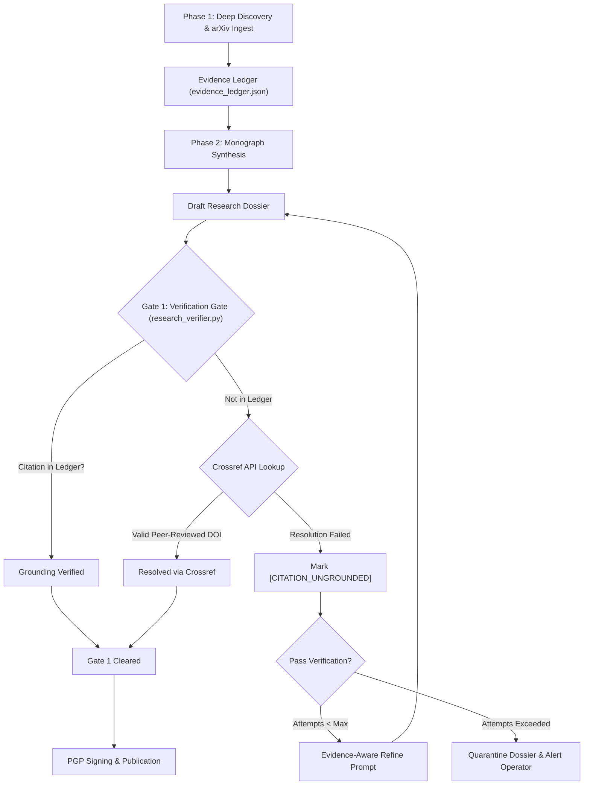

# Research Verifier & Citation Grounding Gate

The **Research Verifier** (`lib/tools/research_verifier.py`) enforces strict epistemic grounding on all autonomous research monographs, scientific literature reviews, and technical dossiers produced by George. It ensures that no hallucinated citations, synthetic equations, or fabricated claims reach publication.



---

## 1. The Epistemic Grounding Problem

In multi-phase autonomous research, agents often collect genuine references during initial search (Phase 1), but hallucinate or misattribute citations during synthesis or style-refinement (Phase 2/3):
- Replaced actual authors with well-known figures.
- Synthetic mathematical equations attributed to existing papers.
- Completely fabricated DOIs or arXiv identifiers.

The **Blue Lodge Research Verifier** prevents this through a cryptographic and evidentiary chain of custody.

---

## 2. Gate 1 Verification Mechanics

### A. The Phase-1 Evidence Ledger
During initial retrieval (`lib/tools/research_graph.sh`), every fetched document, arXiv abstract, PDF, or HTML page is indexed into `.george/research/<run_id>/evidence_ledger.json`:
```json
{
  "ledger_id": "ev_1791157134",
  "sources": [
    {
      "id": "src_01",
      "type": "arxiv",
      "identifier": "arXiv:2401.04088",
      "title": "Mixtral of Experts",
      "authors": ["Albert Q. Jiang", "Alexandre Sablayrolles", "Arthur Mensch"],
      "doi": "10.48550/arXiv.2401.04088",
      "url": "https://arxiv.org/abs/2401.04088",
      "hash_sha256": "8a3f..."
    }
  ]
}
```

### B. Ingestion & AST Citation Extraction
The verifier parses markdown references using regex and AST matching:
- Markdown links: `[Author et al.](https://arxiv.org/abs/...)`
- Parenthetical citations: `(Jiang et al., 2024)` or `[1]`
- DOI patterns: `10.\d{4,9}/[-._;()/:A-Z0-9]+`
- arXiv patterns: `arXiv:\d{4}\.\d{4,5}`

### C. Resolution Cascade
For every cited reference:
1. **Ledger Match**: Check if the identifier, URL, DOI, or title matches a source in the run's `evidence_ledger.json`.
2. **Crossref Fallback**: If the reference was cited from general knowledge or external training weights, query `https://api.crossref.org/works/{doi}` or query the Crossref title search API:
   - Validates existence, primary author surname, and publication year.
   - If confirmed, the source is appended to the ledger with a `CROSSREF_VERIFIED` tag.
3. **Ungrounded Detection**: If neither lookup succeeds, the citation is flagged:
   `[CITATION_UNGROUNDED: "Author, 2024, Fake Paper Title"]`.

---

## 3. Evidence-Aware Refinement & Quarantine

### Evidence-Aware Refine Prompt
When Gate 1 fails:
- The agent does **not** regenerate from scratch.
- The refine prompt receives the current draft, the list of ungrounded references, and the authoritative `evidence_ledger.json`.
- The agent is instructed under a strict prompt constraint:
  > *"Remove or replace the ungrounded citations using ONLY sources from the evidence ledger. You may NOT introduce new external references during refinement."*

### Quarantine Protocol
If a dossier fails Gate 1 after three consecutive refinement attempts:
1. The document is moved to `.george/research/quarantine/<run_id>_quarantined.md`.
2. A cryptographic tamper seal (`.quarantine.sig`) is created.
3. An alert is dispatched to the operator via the event bus:
   `⚠️ Research Monograph failed Gate 1 grounding check: 2 ungrounded references. Quarantined for review.`

---

## 4. CLI & Automated Testing
```bash
# Verify a research dossier manually
python3 lib/tools/research_verifier.py \
  --draft dossiers/research/quantization_monograph.md \
  --ledger .george/research/run_42/evidence_ledger.json

# Run unit tests
bash tests/run_all.sh test_research_verifier
```

---

## 5. Related Documentation
- [[EVENT_BUS_AND_OSINT_PIPELINE|Event Bus & OSINT Pipeline]] — Autonomous research triggers.
- [[AGENT_LOOP|Agent Loop & ReAct Reasoning]] — Multi-turn reasoning and tool invocation.
- [[PGP_SIGNING|PGP Signing Guide]] — Cryptographic signing of finalized dossiers.
- [[NEURIPS_2026_BLUE_LLAMA_CHAMPION_V5|Champion-v5 Research Paper]] — Example grounded monograph.
- [[QWEN38_FRONTIER_RESEARCH_AGENDA|Qwen 3.8 Research Agenda]] — Frontier experimentation plans.
