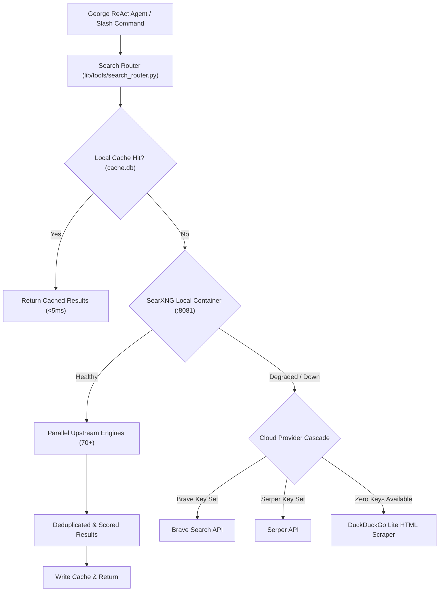

# SearXNG Sovereign Metasearch Architecture

Blue Lodge integrates **SearXNG** (`http://127.0.0.1:8081`) as its primary, privacy-respecting metasearch engine. Running in a lightweight Docker container, it aggregates results across 70+ external search services (Google, Bing, DuckDuckGo, Brave, GitHub, arXiv, Wikipedia, PubMed, Reddit, Qwant) without requiring API keys, tracking queries, or leaking operator IP addresses.



---

## 1. Container Infrastructure

The SearXNG service is managed via Docker Compose and bound strictly to localhost:

```yaml
# docker-compose.yml snippet
george-searxng:
  image: docker.io/searxng/searxng:latest
  container_name: george-searxng
  restart: unless-stopped
  ports:
    - "127.0.0.1:8081:8080"
  volumes:
    - ./config/searxng:/etc/searxng:ro
  environment:
    - SEARXNG_BASE_URL=http://127.0.0.1:8081/
    - SEARXNG_SECRET=${SEARXNG_SECRET}
```

### Health & Secret Provisioning
- `scripts/infra/init_secrets.sh` generates a cryptographically secure random secret for `SEARXNG_SECRET` during installation.
- The health probe monitors `http://127.0.0.1:8081/healthz`.

---

## 2. MCP Server Suite (`lib/tools/mcp_server_searxng.sh`)

SearXNG is exposed to George via a dedicated 8-tool MCP JSON-RPC standard I/O server:

| Tool Name | Scope & Function |
| --- | --- |
| `searxng_search` | General web search across top aggregate engines with pagination. |
| `searxng_it` | IT and software developer focus (GitHub, StackOverflow, ArchWiki, crates.io). |
| `searxng_science` | Academic literature search (arXiv, PubMed, Semantic Scholar, Crossref). |
| `searxng_news` | Real-time news and breaking updates across international news wire sources. |
| `searxng_images` | Image search returning direct media URLs, dimensions, and thumbnails. |
| `searxng_categories` | Lists all supported category filters and active backend engines. |
| `searxng_engines` | Inspects current status, average latency, and error counts per engine. |
| `searxng_health` | Returns instant circuit breaker status and degraded engine tallies. |

---

## 3. Search Router & Fallback Cascade (`search_router.py`)

To ensure high availability even when upstream search engines rate-limit, Blue Lodge utilizes an automated 5-stage cascade:
1. **Cache Layer**: SQLite/in-memory LRU cache stores prior search results (default TTL 1 hour).
2. **Local SearXNG**: Parallel aggregate query across active categories.
3. **Brave Search API**: First cloud fallback if `BRAVE_API_KEY` is present.
4. **Serper API**: Second cloud fallback if `SERPER_API_KEY` is present.
5. **DuckDuckGo Lite**: Headless zero-dependency HTML fallback that operates anywhere without credentials.

### Circuit Breaker & Degraded Engine Detection
- When an individual engine inside SearXNG fails (CAPTCHA, timeout > 3s, HTTP 429), it is automatically blacklisted in `.george/state/search_health.json` for 15 minutes.
- Traffic automatically shifts to healthy alternatives without interrupting agent reasoning.

---

## 4. Slash Commands & CLI

```bash
# General query via CLI
lodge /searxng "Cardano Plutus V3 CIP-1694"

# Search developer sources specifically
lodge /searxng it "axum websocket upgrade example"

# Academic science search
lodge /searxng science "hybrid state space attention models"

# Check engine health and circuit breakers
lodge /searxng health

# Restart SearXNG container if needed
docker restart george-searxng
```

---

## 5. Related Documentation
- [[MCP|Model Context Protocol Guide]] — MCP server configuration and client routing.
- [[RESEARCH_VERIFIER|Research Verifier]] — Validating research citations discovered via search.
- [[LRU_CACHE|LRU Cache Reference]] — Local search caching and deduplication.
- [[DOCKER_SANDBOX|Docker Sandbox]] — Container runtime management and security.
- [[EVENT_BUS_AND_OSINT_PIPELINE|Event Bus & OSINT Pipeline]] — Autonomous search monitoring.
