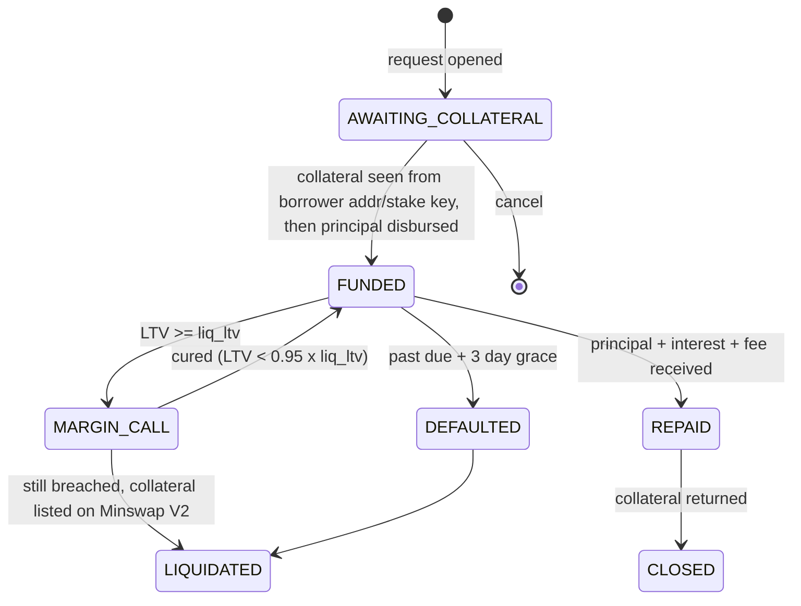
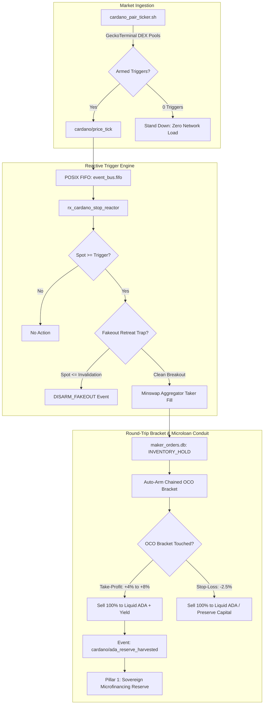

# Sovereign DEX & Lending — Operator and Analyst Guide

> **Audience:** the human operator, the analyst reviewing George's work, and George himself.
> **Scope:** the *Sovereign Fund & Lending* pane, the *Sovereign DEX Desk*, the automated trading
> loop and reactors, and the George tools that drive them.
> **Purpose:** teach you to read each tool, understand what it computes, tell a **real** opportunity
> from a mirage, and know which risks you are actually taking.

All screenshots come from the live workbench (`http://localhost:3000` → **TOOLS** drawer). Numbers in
them are real snapshots from 3–4 Oct 2026. They will be different when you read this.

---

## Contents

1. [Mental model: five rules](#1-mental-model-five-rules)
2. [Who does what: operator, George, automation](#2-who-does-what-operator-george-automation)
3. [Daily routine checklist](#3-daily-routine-checklist)
4. [Treasury & Allocation](#4-treasury--allocation)
5. [Opportunities feed](#5-opportunities-feed)
6. [Fund ledger](#6-fund-ledger)
7. [Microloan Underwriter](#7-microloan-underwriter)
8. [Loan book & servicing lifecycle](#8-loan-book--servicing-lifecycle)
9. [Calibrated Price Ladder](#9-calibrated-price-ladder)
10. [Limit-order fill forecaster](#10-limit-order-fill-forecaster)
11. [Sovereign DEX Desk](#11-sovereign-dex-desk)
12. [Maker corridors, cycles and the sell reactor](#12-maker-corridors-cycles-and-the-sell-reactor)
12b. [Breakout stop-orders & Sovereign ADA Accumulator bracket (Engine C)](#12b-breakout-stop-orders--sovereign-ada-accumulator-bracket-engine-c)
13. [Pool Health](#13-pool-health)
14. [Yield Board](#14-yield-board)
15. [Polymarket complete sets](#15-polymarket-complete-sets)
16. [Flash sniper](#16-flash-sniper)
17. [Surveillance loop and dossier](#17-surveillance-loop-and-dossier)
18. [When does an opportunity really exist?](#18-when-does-an-opportunity-really-exist)
19. [Risk register](#19-risk-register)
20. [Working with George](#20-working-with-george)
21. [Troubleshooting](#21-troubleshooting)
22. [Reference: CLI, George tools, HTTP API](#22-reference-cli-george-tools-http-api)
23. [Glossary](#23-glossary)

---

## 1. Mental model: five rules

1. **Everything is priced in ADA.** All Cardano tools (forecaster, ladder, underwriter, volatility
   engine, pool health) use **ADA-quoted** pool OHLCV from GeckoTerminal. USD is only for the treasury
   view. Never compare an ADA-quoted sigma with a USD-quoted one.
2. **Chain truth beats local state.** Order status, deadlines and locked amounts come from Cardano
   UTxOs (`cardano_orders.py`). The `maker_orders.db` cycle table is bookkeeping. If they disagree,
   the chain is right. Use **RECONCILE ON-CHAIN**.
3. **"Unavailable" means unavailable.** Tools show `NO_DATA`, `UNKNOWN`, `unavailable` or a warning
   rather than invent a number. Treat a missing number as a **stop** sign, not as zero risk.
4. **Gross is not net.** Every spread must clear fixed L1 fees, batcher fees, the 2 ADA order deposit,
   pool fees and your own price impact. On a 20–150 ADA book, those fixed costs dominate.
5. **Dry run first, always.** Every write path (place, reclaim, disburse, liquidate, return
   collateral) has a dry run. Broadcasts need an explicit `execute` flag plus a typed `BROADCAST`
   confirmation in the UI.


*The Sovereign Fund & Lending pane. From the top: treasury, opportunities, underwriter, loan book,
ledger, price ladder, pool health, yield board, Polymarket. Maker corridors and the forecaster are
further down.*

---

## 2. Who does what: operator, George, automation

| Actor | Can do | Cannot do |
|---|---|---|
| **Operator** (you, UI or CLI with `--actor operator`) | Anything: allocate capital, set policy, place/reclaim orders, open loans, execute servicing. No caps. | — (you are the last line of defence) |
| **George** (agent tools, `--actor george`) | Read everything. Underwrite. Open loan requests. Run servicing dry runs. Execute servicing **within the wallet policy**. Record `profit_sweep` / `expense` ledger entries. Place limit orders inside policy. | Allocate or withdraw fund capital. Change policy. Exceed **25 ADA per tx / 60 ADA per day**. Return collateral unless the loan is `REPAID`. Disburse to an address other than the one on the book. |
| **Automation** (cron loop, reactors) | Scan every 300 s. Write the status file and dossier. Emit `sovereign_trading_tick` when something is actionable. The maker sell reactor can list a sell leg for a filled buy. | Disburse loans. Allocate capital. Act on a cycle with `operator_hold` set. |

> [!IMPORTANT]
> A policy **denial is final**. If George's tool returns `denied`, he must report it, not retry with
> other parameters or route around it. Only the operator can override, and should do so deliberately.

> [!WARNING]
> George and the web server run under the same Unix user. The policy is enforced in code paths
> (`lib/tools/wallet/policy.py`), not by OS permissions. A shell command that calls the signer directly
> could bypass it. That is why George must use the tools, and why you should audit `bash_exec` output
> that touches `keystore` or `.george/wallets`.

---

## 3. Daily routine checklist

Spend about 10 minutes.

1. **Treasury** — anything new marked `LOCKED`? Does liquid ADA cover the next planned action plus
   ~5 ADA of fees?
2. **Opportunities** — work through P1 → P3 items. Ignore P5–P6 unless you are idle.
3. **Loan book** — any `MARGIN_CALL`, past-due or `AWAITING_COLLATERAL` older than a day?
   Press **SERVICE (DRY RUN)** and read the plan.
4. **Open orders** — for each open order, check its odds (desk **ODDS** or the forecaster). If P(72h)
   is below 0.35, decide: hold, reprice (ladder) or reclaim.
5. **Pool health** — run **SCAN** before any new trade. Never trade a pair that is not `DEEP_ACTIVE`
   without a reason you can write down.
6. **Dossier** — skim `dossiers/finance/cardano_live_opportunities.md` for the loop's latest view.
7. **Sweep** — if a sweep is due (P3), record it in the ledger.

---

## 4. Treasury & Allocation


### What it shows
- One row per holding: asset, chain, location (hot wallet, order UTxO, bridged USDC.e, …), amount,
  USD value and a badge:
  - `LIQUID` — spendable now.
  - `LOCKED` — inside an order script, or stranded (e.g. USDC on Ethereum with no ETH for gas).
- Allocation bars: share of treasury per asset. The **white tick** is the policy target. The right
  column shows the USD needed to reach the target (`+`) or the excess (`−`).

### Under the hood
- `sovereign_fund.py treasury` merges:
  - the Cardano hot wallet (Blockfrost/Koios);
  - open order UTxOs from `cardano_orders.py` (tokens in orders count toward the asset, and their ADA
    toward ADA);
  - Polygon and Ethereum balances (POL, native USDC, USDC.e, ETH);
  - BTC watch addresses, if configured in `fund_policy.json` → `btc_watch_addresses`.
- Prices come from CoinGecko (timestamp in the header). Cardano tokens are valued through their ADA
  pool price.

### How to read it
- **ADA-equivalent NAV** is the denominator for every percentage. Locked funds are still yours but
  cannot be used for new trades or loans.
- A row reading `stranded: no ETH for gas` means the funds can only move after you send gas to that
  chain. See [§5](#5-opportunities-feed), priority P2.
- BTC shows `0.0%` until a watch address is set. That is configuration, not a real zero.

### Decisions
- Allocation gaps become opportunities only above **max($5, 5 % of NAV)**. Below that, rebalancing
  fees exceed the benefit. Ignore small gaps.
- The treasury is **not** the loan fund. Underwriting capacity comes from the [ledger](#6-fund-ledger).

---

## 5. Opportunities feed

### What it shows
A prioritised list (P1 = most urgent). Each item has a title, the numbers behind it and a suggested
next step (`→ …`).

| Kind | Priority | Fires when | Typical action |
|---|---|---|---|
| `order_health` | **P1** if P(72h) < 0.35, else P5 "hold" | An open order exists | Reprice to the suggested rung (chosen from a 21-rung, 8 % ladder at P(24h) ≥ 70 %), or reclaim |
| `stranded` | P2 | Value on a chain with no gas token. Gas needed ≈ gwei × 70 000 × 3 | Send a little native gas, then move funds |
| `loan` | **P2** if `MARGIN_CALL`/`DEFAULTED`, else P4 | Loans in the book | Service: dry run, then execute |
| `sweep` | P3 | Sweep due > 0.5 ADA | Ledger `profit_sweep` entry |
| `fund` | P3 | No earmarked capital | Ledger `allocate` entry (operator) |
| `allocation` | P4 | Gap > max($5, 5 % NAV) | Rebalance (manual or DEX) |
| `yield` | P6 | Idle USDC | Informational — no deposit integration yet |

### Under the hood
`sovereign_fund.py opportunities` recomputes everything from live data on each call: treasury,
forecaster odds for every open order, loan state and the ledger. Nothing is cached except yields (1 h).

### Diagnosing
- **An order shows P5 "hold" but you know it is stuck** → check the deadline. Expired orders show up
  as reclaim items. If the forecaster could not fetch OHLCV, the item carries a warning and **no**
  probability. Treat that as unknown, not as safe.
- **`fund` item will not clear** → only an `allocate` ledger entry from the **operator** clears it.
  George cannot allocate.

---

## 6. Fund ledger

### What it is
An append-only JSONL ledger that defines the **loan fund**, separate from the general treasury.

| Entry type | Sign | Who may record |
|---|---|---|
| `allocate` | + available | Operator |
| `withdraw` | − available | Operator |
| `profit_sweep` | + available | Operator, George |
| `expense` | − available | Operator, George |
| `disburse` / `repay` / `interest` / `liquidation` | Moves between available and outstanding | Lending service (automatic) |

- **NAV = available + outstanding principal.**
- **Sweep due** = realised maker profit × `profit_sweep_pct` (50 %) − amount already swept.

### Decisions
- **Underwriting capacity = min(available, 40 % × NAV).** With an empty ledger, capacity is 0 and every
  loan is rejected for capacity (see the SNEK example below). This is by design: no allocation, no
  lending.
- Record **why** in the note field (`seed allocation from IAG proceeds`). The ledger is your audit
  trail.

---

## 7. Microloan Underwriter

The underwriter answers one question: *at this LTV, term and APR, is lending against this collateral
expected to make money, with tail risk inside policy?*

### Inputs
Collateral asset and units · principal asset · principal · term (days) · offered APR · borrower
Cardano address (only needed to open a request) · note.

### Under the hood (`sovereign_lending.py`)
1. **Asset class**, relative to the principal asset, sets the liquidation LTV:
   - **stable** (USDC/DJED against USDC) → `liq_ltv` 0.90;
   - **major** (ADA, BTC, ETH, POL, USDC, DJED) → 0.80;
   - **token** (SNEK, IAG, MIN, …) → 0.70.
2. **Liquidation slippage**: for tokens, a constant-product (CPMM) model with a 0.3 % fee on live pool
   reserves, sized to the whole collateral. For majors, a flat 1 %.
3. **Term risk**, with `ltv0` the starting LTV and `i` the term interest:
   - Liquidation ratio = `ltv0 / liq_ltv`. Underwater ratio = `ltv0 × (1 + i) / (1 − slip)`.
   - **Closed-form**: GBM first-passage probability using *horizon sigma* (from overlapping T-day
     returns, not √T-scaled daily sigma).
   - **Empirical**: every historical T-day window on daily **lows**. Liquidation is checked daily and
     executes at the close, never better than the trigger.
   - **P(liquidation) = median** of the two methods. **P(underwater) = max** (conservative).
     Expected loss (EL) comes from the empirical windows.
4. **Max safe LTV**: bisection for the highest LTV with P(underwater) ≤ 5 % **and**
   P(liquidation) ≤ 25 %.
5. **Required APR** = annualised (EL + liquidation cost) + **cost of capital** (deepest reputable
   pool's APY, see [§14](#14-yield-board)) + **4 % risk margin**.
   - Liquidation cost = 2.5 ADA × P(liq) / principal.
   - Origination fee: 0.6 ADA (covers L1 servicing costs), owed with principal and interest.

### Verdicts
| Problem | Hard/soft |
|---|---|
| LTV ≥ liquidation trigger | hard |
| LTV > max safe LTV | hard |
| Offered APR < required APR | hard |
| Term > policy max (60 d) | hard |
| Principal < minimum (5 ADA) | hard |
| Principal > capacity | soft |
| History < max(30, T + 10) daily bars | soft |

- **APPROVE** — no problems.
- **COUNTER** — a smaller principal (≥ min loan) at max safe LTV works and the address is valid.
  The counter shows principal @ APR.
- **REJECT** — anything else.

### Worked example A — good risk, no capacity (SNEK)


*20 000 SNEK (≈ 53 ADA) for 20 ADA, 30 days, 25 % APR.*

- LTV **37.7 %** against max safe **55.5 %**, liquidation LTV 70 %. P(liq) and P(underwater) ≈ **0.00 %**.
- Required APR **6.97 %** (cost of capital 2.97 % + 4 % margin + tiny EL). 25 % offered → expected net
  **+0.36 ADA** after the 0.6 ADA fee.
- The **only** problem: `principal exceeds fund capacity 0.00 ADA`. **Fix: allocate capital.** The
  risk is fine.

> [!NOTE]
> +0.36 ADA on 20 ADA for 30 days is small. Fixed costs (0.6 ADA fee, ~0.2–0.4 ADA per servicing tx)
> make loans under ~20 ADA barely worth the custody risk. Prefer fewer, larger loans within the 40 % cap.

### Worked example B — the risk itself is the problem (IAG)


*400 IAG (≈ 36 ADA) for 20 ADA, 30 days, 25 % APR.*

- LTV **55 %** > max safe **51 %**. P(liq) **34 %**, P(underwater) **12 %** — both outside policy.
- Required APR **65.9 %**. Expected net **−0.61 ADA**.
- Collateral needed at max safe LTV: **431 IAG**. That is what to ask the borrower for. Even then,
  IAG's thin history and 4.5 % daily sigma make it a weak collateral token.

### Analyst checks
- Is **σ daily** plausible for the token? (SNEK ~4 %, IAG ~4.5 %, majors 2–4 %.)
- Is the **pool depth** large enough that liquidation slippage is not under-estimated? See Pool Health.
- If the *history* problem fires, the risk numbers come from too few windows. Do not override.

---

## 8. Loan book & servicing lifecycle



### Servicing (`lending_service`)
- **SERVICE (DRY RUN)** prints the plan: what each loan would do now (detect collateral, disburse, mark
  margin call, liquidate, return collateral). `DRY RUN · 0 loan(s) · nothing to service` is the
  healthy idle state.
- **SERVICE & EXECUTE** performs the plan. It needs `execute: true` **and** a typed `BROADCAST`.

### Safety rails
- Collateral counts only when sent **from the borrower's address or stake key**.
- Disbursement is allowed only from `AWAITING_COLLATERAL`, only to the address on the book, with a
  CIP-20 message.
- `REPAID` is persisted to disk **before** collateral is returned. A crash mid-return cannot pay out
  twice.
- Liquidation lists a calibrated Minswap V2 rung. It is not a market dump.

> [!CAUTION]
> **Custody is trust-based.** Collateral sits in the fund hot wallet, not in an escrow script. The
> borrower trusts you, and your security is the hot-wallet key. Only ADA-principal loans backed by
> Cardano-native collateral are serviced automatically. USDC loans are manual.

---

## 9. Calibrated Price Ladder


### What it shows
For a size (e.g. **SELL 1625 IAG**), each row is a candidate limit price from spot to +span %:
- **premium** over spot;
- **gross ADA** you would receive;
- calibrated fill probability over **6 h / 24 h / 72 h / 7 d**.

The highlighted row is `choose_rung`: the **best price** whose 24 h probability meets the PICK
threshold (default 70 %).
- Sell → the highest price meeting the threshold.
- Buy → the lowest price meeting the threshold.

### Under the hood
For each rung, the forecaster ([§10](#10-limit-order-fill-forecaster)) computes the **executable
trigger**: the pool spot at which a batcher can fill your **whole** order after the 0.3 % fee and your
own price impact, plus a 0.3 % touch haircut. Probabilities are first-passage odds of spot reaching
that trigger.

### Reading the example
Spot 0.09085, σ 1.18 %/h:
- **0.0 % premium** → 82 % in 24 h, 147.63 ADA;
- **+0.5 %** → 71 %, 148.37 ADA (highlighted);
- **+4 %** → 14 %, 153.54 ADA.

Going from +0.5 % to +4 % earns **+5.2 ADA** but cuts the 24 h odds five-fold.

### Decisions
- Want liquidity (free capital for a loan or rebalance)? Take the highlighted rung or lower.
- Want profit and can wait? Pick a rung with P(7 d) ≥ 0.5 and accept that capital sits idle.
- Fixed friction per round trip is ~2.2 ADA on the sell side. A rung must clear cost basis + 2.2 ADA +
  0.75 ADA minimum profit to be a "profitable" exit.
- The ladder does **not** place orders. Place the chosen rung from the DEX Desk ticket.

---

## 10. Limit-order fill forecaster


### What it shows (`limit_order_forecaster.py`, schema `limit_order_forecast/v2`)
- **Spot vs executable trigger**: distance in % and in hourly sigmas (e.g. +0.74 % = 0.63σ).
- **Median time to trigger** (closed form).
- **24 h / 7 d fill probability** (effective).
- **Limit vs market now**: ADA gained if filled, compared with swapping at market (price impact
  included).
- **Model diagnostics**: ADF p-value, Hurst exponent, whether OU mean reversion is actionable.
- **By-method table**: closed / boot / empirical (with Wilson 95 % CI) / **effective**.

### Under the hood
1. The order is resolved **from chain** when one exists: status, deadline, size. `--hypothetical`
   prices a new order instead.
2. Four methods:
   - **Closed form**: GBM first passage with horizon sigma. Drift is zero unless statistically
     significant.
   - **Block bootstrap** of actual hourly returns (keeps volatility clustering).
   - **Empirical hit rate**: how often, historically, the max (sell) or min (buy) over the horizon
     reached the same distance. Wilson CI.
   - **OU**: only when ADF rejects a random walk. Otherwise shown as "not actionable".
3. **Effective = median** of the available methods. One method cannot dominate.
4. **Calibration**: walk-forward Brier scores per token (IAG 0.186, SNEK 0.142, MIN 0.241). Lower is
   better; 0.25 is a coin flip. MIN's odds are barely better than chance, so trust them less.

### recommended_action
| Value | Meaning |
|---|---|
| `hold` | P(7 d) ≥ 0.5 |
| `consider_repricing` | P(7 d) < 0.5 — check the ladder |
| `reclaim` | Order expired; batchers will never fill it. Probability forced to 0 |
| `wait_for_batch` | Spot is already through the trigger; a batcher should fill soon. If not filled after an hour or two, inspect the order |

### Diagnosing disagreements
- **Closed form ≫ empirical** → recent volatility is higher than history, or a jump. Trust the
  empirical number and its CI.
- **Bootstrap ≫ others** → fat tails or clustering in the recent window. The effective median protects
  you.
- **Wide empirical CI** (e.g. 40–54 %) → few windows. Treat the point estimate as ±7 pp.
- **Different numbers in the finance pane and the desk** → check that both use the same direction,
  limit and size. The finance-pane card auto-fills the active order; the desk uses ticket inputs.

---

## 11. Sovereign DEX Desk


### KPIs (top row)
- **Pool spot** and depth (ADA reserve).
- **Hourly σ and 24 h ±1σ cone.**
- **Mean reversion**: `Not significant` (ADF p = 0.75) means OU bands are descriptive only. Do not
  trade "back to the mean".
- **Active wallet** balance.

### Chart overlays (toggle beneath the chart)
- **Orders**: your on-chain limits, labelled with status (`EXPIRED` in red).
- **Exec. trigger** (orange): where the batcher can actually fill. It sits *beyond* your limit
  because of fee and impact.
- **Cost basis** (purple): your average entry. Selling below it locks in a loss.
- **Vol cone ±1σ/2σ** and **OU bands** (only if significant).
- **Pool trades** and **ticket price** (white).

### Ticket workflow: ANALYZE → PREVIEW → PLACE
1. **FILL ODDS**: hypothetical odds table for the ticket's side, amount and limit.
2. **DRY RUN**: builds the transaction without signing. It shows locked ADA (amount + **2 ADA
   deposit** + up to **2 ADA batcher fee**), trigger, datum validation and L1 fee. A failure here costs
   nothing.
3. **PLACE…**: opens a modal; you must type `BROADCAST`. Native Minswap V2 limit datum with no
   deadline: it rests until filled or reclaimed.


*A dry run that fails safely. `UTxOSelectionException: All UTxO selectors failed` — the wallet did not
hold the 1 625 IAG the ticket tried to sell (they were locked in the expired order). Reclaim first.*

### On-chain orders (chain truth)
**SCAN CHAIN** reads your order UTxOs and recent transactions. Each row has:
- **INSPECT**: protocol, owner check, locked value, `min_receive`, deadline.
- **ODDS**: the forecaster for that exact UTxO.
- **RECLAIM**: a dry run with Plutus script evaluation, then a separate **BROADCAST RECLAIM**.


*An **expired** WingRiders order. Effective odds are forced to **0.0 %** even though the raw methods
say 16–20 % in 24 h. Batchers ignore orders past their deadline. Action: RECLAIM.*

### Wallet tabs
WALLETS (create/import) · SEND · SIGN/verify · **GEORGE** (edit George's wallet policy: allowed
actions, allowed assets, per-tx and per-day caps). Operator actions are not capped.

---

## 12. Maker corridors, cycles and the sell reactor


### Corridors table (`cardano_market_maker.py`)
For each pair:
- resting **bid** and **ask** around spot;
- **spread** and its σ-equivalent;
- expected fill horizon;
- capital (default 120 ADA);
- **net cycle profit**;
- status: `VIABLE`, `EXPAND (spread)`, `INVENTORY HOLD`.

Spread = max(fixed friction + 2 × slippage, k × σ_Parkinson × √T).

### How to read "net cycle profit"
- It assumes **both legs fill**. Round-trip friction is ~**3.96 ADA**: two L1 fees, two batcher fees,
  pool fees. The 2 ADA deposits come back. Reserve floor: 10 ADA.
- +0.6 to +1.4 ADA on 120 ADA is **0.5–1.2 % per cycle, if both legs fill**. In practice the second
  leg is where you get stuck: you buy, price drifts, and the ask is never touched.
- `INVENTORY HOLD` means you already hold the token (here 1 625 IAG). Do not open another IAG cycle.
  Exit the inventory first.

### Cycles (`maker_orders.db`)
The cycle state machine is: buy → filled → **pending sell** → realised. The cost basis is recorded.
**RECONCILE ON-CHAIN** fixes drift between the database and the chain.

### Sell reactor (`maker_sell_reactor.py`)
When a buy fills, the reactor lists the sell leg. Modes (per-cycle `sell_mode` metadata, or env
`MAKER_SELL_MODE`):

| Mode | Rule |
|---|---|
| `auto` (default) | Cost-plus (basis + 2.2 ADA friction + 0.75 ADA profit) if P(72 h) ≥ 0.5; otherwise the best break-even rung |
| `liquidity` | Best rung with P(24 h) ≥ 0.7, accepting a loss down to **10 %** (`MAKER_MAX_LOSS_PCT`) |
| `profit` | Legacy fixed cost-plus, no odds check |

Other behaviour:
- `operator_hold: true` on a cycle makes the reactor skip it.
- Each cycle is claimed in the database (idempotent), with a 30-minute cooldown.

> [!WARNING]
> **Case study — the IAG incident.** The old reactor relisted IAG at cost-plus with about **15 %**
> fill odds and a WingRiders deadline. The order expired and sat as dead capital for days. Lessons:
> (1) never list without checking odds; (2) prefer deadline-free Minswap V2 limits; (3) watch for
> `order_health` P1 items. The order was reclaimed and relisted at 0.09121 ADA (~74 % in 24 h).

---

## 12b. Breakout stop-orders & Sovereign ADA Accumulator bracket (Engine C)

### Strategic Mandate: Sovereign ADA Accumulation ($1\text{ ADA} = 1\text{ ADA}$)
Our trading objective across Cardano Native Tokens (SNEK, MIN, IAG, DJED, WMTX) is **raw ADA accumulation**. USD fiat valuation is treated as irrelevant. All surplus ADA harvested from volatility breakouts directly capitalizes the **Pillar 1 Sovereign Microfinancing Loan Pool** ([§7](#7-microloan-underwriter)), enabling George to underwrite over-collateralized $\le 50\%$ LTV P2P credit.

### USD Macro Gate: Bypassed by Default
When ADA pulls back in USD terms, CNT pairs often experience heightened volatility and wider cross-DEX trading corridors. The USD Macro Gate (`--gate-ada-24h`) defaults to `-999.0` (bypassed), allowing George to capture high-velocity ADA accumulation cycles unhindered by fiat sentiment. The parameter remains fully configurable should operator objectives change.

### Bracketed Round-Trip Lifecycle



### Agentic Execution Graph ("Graphic")

```text
  [Phase 1: 48h Coil Volatility] ──> [Phase 2: Headroom Sizing (maker_orders.db)]
               │                                      │
               v                                      v
  [Phase 3: Fakeout Trap Guard]   ──> [Phase 4: Breakout Buy Fill]
               │                                      │
               v (if price retreats)                  v
      [DISARMED_FAKEOUT]             [Phase 5: Auto-Chain OCO Bracket]
                                                      │
                                                      v
                                     [100% Returned to Liquid ADA]
                                                      │
                                                      v
                                     [Emit: cardano/ada_reserve_harvested]
```

### Key Technical Safeguards
1. **48-Hour Coil Detection (`cardano_stop_engine.py calc <asset>`)**:
   Analyzes hourly OHLCV to formulate breakout triggers (+1.5% above coil high) and invalidation disarm levels (coil midpoint).
2. **Dynamic Headroom Sizing (40.0 ADA Reserve Floor Guard)**:
   Dynamically queries hot wallet balance and `maker_orders.db` to calculate spendable capital (`total_ada - 40.0 ADA floor`). George dynamically sizes positions up to available headroom without arbitrary pair ceilings, strictly preserving the 40.0 ADA untouchable treasury floor.
3. **Fee Drag Hurdle**:
   Enforces a 1.24% round-trip fee floor (0.3% pool fee + 0.15% batcher toll + slippage cap), ensuring Take-Profit targets (+4% to +8%) deliver real net ADA expansion.
4. **Fakeout Retreat Trap**:
   If spot breaches the breakout trigger but fails to hold and retreats below the invalidation line, the trigger automatically disarms (`DISARMED_FAKEOUT`), preventing high-water mark traps.
5. **Round-Trip Closure**:
   CNTs are never held long-term under Engine C. 100% of inventory is liquidated back to native ADA upon hitting Take-Profit or Stop-Loss, routing realized yield directly to the loan pool.

### Operator & George CLI Reference
```bash
/trading stops status                                       # View armed triggers, distances, and macro gate
/trading stops calc SNEK                                    # Calculate 48h coil bounds, headroom, and targets
/trading stops arm SNEK --trigger 0.0035122 --amount 25.0   # Arm breakout trigger (dry-run by default)
/trading stops cancel <trigger_id|all>                       # Disarm and cancel an active trigger (or all)
/trading stops prune [--max-age <sec>] [--all]              # Prune stale/aborted stop triggers
/trading graph stops                                        # Launch reactive daemon to process tick events
/trading graph                                              # Display Triple Execution Engine Architecture
```

---

## 13. Pool Health

*(Shown in the ladder screenshot above, lower left.)*

`dex_liquidity_squeeze_detector.py` (v2) classifies each pair from GeckoTerminal:

| Health | Gate | Rule |
|---|---|---|
| `STALE_TRAP_HAZARD` | `HARD_ABORT_TRAP` | No trade for > 6 h, or ADA reserve < 15 000 |
| `SHALLOW_CAUTION` | `REDUCE_ORDER_SIZE` | A 50 ADA trade moves price > 1.8 % |
| `VOLATILITY_SQUEEZE_COILING` | `EXPAND_SPREADS` | 24 h σ / 7 d σ ≤ 0.5 (calm before a move) |
| `DEEP_ACTIVE` | `PERMIT_TRADES` | Otherwise |
| `UNKNOWN` | `NO_DATA` | Pair not found. `--check-trap` exits 1 |

Columns:
- **reserve** (ADA side);
- **last** trade age;
- **impact 100A** (price impact of 100 ADA);
- **venue Δ** (cross-venue dispersion).

> [!TIP]
> A large **venue Δ** looks like arbitrage but usually is not. IAG showed **3.41 %**, but the other
> venue is a 5 800-ADA Minswap pool. Moving 50 ADA through it erases the gap, and two sets of fees
> come first. Venue Δ is a *data-quality* signal unless both pools are deep.

---

## 14. Yield Board


- Source: DeFiLlama, filtered to reputable projects (aave-v3, compound-v3, liqwid, spark,
  morpho-blue, lido, indigo, rocket-pool) with TVL ≥ $1 M, cached 1 h.
- **Best venue / APY**: the highest base APY. Often a small, incentive-driven pool. Not the benchmark.
- **Deepest pool**: the highest-TVL pool's APY. This is the **cost of capital** the underwriter uses
  (ADA = 2.97 % on Liqwid). A loan must beat what you could earn passively at low risk.
- Informational only. The harness does not deposit into these protocols.

---

## 15. Polymarket complete sets

*(Right half of the screenshot above.)*

### Under the hood (`polymarket_probability_arbitrageur.py`, read-only)
- **Binary**: buy YES + NO at the best asks. Payout is exactly 1 USDC.
- **Neg-risk**: buy every outcome of a mutually exclusive event. Exactly one pays 1.
- Cost = Σ best asks + taker fees. Fee per leg = baseRate bps × min(p, 1 − p).
- Depth = the smallest size available at the best ask across legs. Minimum order is 5 shares.
- **Augmented** neg-risk events (where an "other" outcome can be added later) are never viable: the
  set is not complete.

### Reading it
`29 sets scanned · 0 viable · budget $8.45`, with Σ ask 1.001–1.010 and edge −0.1 % to −1.9 %
(`NO EDGE`). This is the normal state. Market makers keep sets at or slightly above 1.

### A real opportunity requires all of:
1. Σ ask + fees < 1.000;
2. depth ≥ 5 shares on **every** leg;
3. not augmented;
4. edge × size > Polygon gas plus your time;
5. resolution risk accepted (disputes, UMA oracle delays — capital locked until resolution).

---

## 16. Flash sniper

`cardano_flash_sniper.py --scan` prices round trips through the Minswap aggregator.

- Friction is ≈ **4.7–6.6 ADA** per round trip. Minimum net profit 1 ADA.
- On 20 ADA of capital, even a **5 % gross** spread nets about **−5 ADA**. On a small book, the sniper
  is almost always a "no" — and that is the correct answer.
- Its ±2 % "resting targets" are arbitrary display values, **not** calibrated. Use the ladder instead.
- A sniper hit becomes plausible only when net > 1 ADA **after** its own friction line, with capital
  > ~150 ADA.

---

## 17. Surveillance loop and dossier

`.george/cron_jobs/sovereign_trading_loop.sh` runs every **300 s**:

1. `lending book` and `lending service` (dry run, as George).
2. `sovereign_fund.py opportunities` and `state`.
3. Flash sniper scan.
4. Polymarket scan, throttled to every 30 min (cache `.george/finance/polymarket_scan_last.json`).

It writes:
- `.george/wallets/sovereign_trading_status.json` (schema `sovereign_fund_loop/v2`);
- `dossiers/finance/cardano_live_opportunities.md` (human-readable).

It emits a `sovereign_trading_tick` event **only when something is actionable** (P1–P3, a loan
action, a viable set). Silence is normal.

**Diagnosing:** if the dossier timestamp is older than ~10 minutes, the loop is not running. Check
**CRON & SWEEPS** in the drawer, or run the script by hand and read stderr.

---

## 18. When does an opportunity really exist?

| Tool | It is real only if… | Common mirage |
|---|---|---|
| **Loan** | Verdict APPROVE (or you accept the COUNTER) · capacity ≥ principal · offered APR ≥ required APR · borrower collateral arrives from their own address · expected net > ~1 ADA | Good risk but capacity 0 · APR "high" but below required for a volatile token |
| **Limit order / ladder** | Rung P(24 h) ≥ 0.7 for liquidity, or P(7 d) ≥ 0.5 for patience · the price clears cost basis + 2.2 ADA (or you accept a loss knowingly) · pool `DEEP_ACTIVE` | High-premium rung with 10–15 % odds (the IAG incident) |
| **Maker cycle** | `VIABLE` · **both** legs have reasonable odds · net cycle profit > 0 after 3.96 ADA · no inventory already held | `+1.4 ADA` on paper while the second leg never fills |
| **Cross-venue Δ** | Both pools deep (> 50k ADA) · Δ > fees on both sides + impact on the smaller pool | 3 % Δ against a 5k-ADA pool |
| **Flash sniper** | Net ≥ 1 ADA after 5–7 ADA friction | 5 % gross on 20 ADA |
| **Polymarket** | Σ ask + fees < 1 · depth ≥ 5 on each leg · not augmented | Σ = 0.99 on mid prices, but asks sum to 1.01 |
| **Rebalance** | Gap > max($5, 5 % NAV) | Chasing $2 gaps with $1 of fees |
| **Yield** | Deposit path exists and APY is not incentive-driven | 12 % "best" APY on a small pool |

**Rule of thumb for George:** if you cannot write the net expected ADA **after all fixed costs**,
with the probability you used, it is not an opportunity yet.

---

## 19. Risk register

| Risk | Where it bites | Mitigation |
|---|---|---|
| **Model risk** — GBM assumes no jumps; history may be short | Underwriter, forecaster, ladder | Median of methods, empirical windows, calibration Brier, history problem flag. Distrust MIN (Brier 0.24). |
| **Liquidity / slippage** | Liquidations, exits, cross-venue | CPMM impact on live reserves, pool health gates, size limits |
| **Stale data** | Every tool | Timestamps on every card; `NO_DATA`/`unavailable`; stale-trap gate |
| **Custody (no escrow)** | Loans | Small loans, 40 % concentration cap, borrower-address checks, REPAID-before-return |
| **Smart contract / batcher** | Orders | Use known scripts (Minswap V2). Dry-run Plutus evaluation before reclaim. Prefer no-deadline datums. |
| **Lost escrow** | Custom scripts | 3 ADA is stuck in the `LodgeEscrowPoC` UTxO. Do not deploy experimental scripts with real funds. |
| **Gas stranding** | ETH/Polygon | 13.98 USDC is stuck on Ethereum until ETH is sent for gas |
| **Watch-only BTC** | Treasury | No signing; values are informational |
| **USDC loans** | Lending | Manual servicing only |
| **Policy bypass** | George | Shared uid: audit shell commands touching keys; "denied is final" |
| **Hot-wallet key compromise** | Everything | Keep fund size small; the wallet is a hot wallet by design |
| **Oracle/resolution risk** | Polymarket | Read-only scanner; resolution delays lock capital |

---

## 20. Working with George

### Tool sequences that work

**"Is my order OK?"**
1. `crypto_orders` (discover) → `crypto_forecast` on the UTxO.
2. If `consider_repricing`: `crypto_price_ladder` (same size) → propose a rung with its odds and ADA.
3. Placement or reclaim goes through `crypto_reclaim_order` / `crypto_place_limit` with **dry run
   first**; report the dry-run output before any execute.

**"Should we lend against X?"**
1. `pool_health` for X/ADA. Stop if not `DEEP_ACTIVE`.
2. `lending_underwrite`. Report the verdict, every problem, LTV vs max safe, P(liq), P(uw), required
   APR and expected net.
3. Only if APPROVE and a borrower address is given: `lending_request`.

**"What should we do today?"**
1. `fund_opportunities` → address P1–P3 items in order. Use `fund_treasury` / `lending_book` for detail.

### Prompts that get good answers
- *"Run fund_opportunities and explain each P1–P3 item with the numbers, then propose one action."*
- *"Underwrite 15 000 SNEK for 20 ADA, 21 days, 18 % APR. If it is not APPROVE, tell me the smallest
  change that would make it APPROVE."*
- *"Build a sell ladder for my IAG. Which rung clears cost basis + friction with ≥ 50 % in 72 h?"*

### George's rules of engagement
1. **Numbers or nothing.** Cite the probability, the friction and the net. No "looks promising".
2. **Dry run before execute**, and report the dry run.
3. **Denied is final.** Report it; do not retry around the policy.
4. **Never allocate or withdraw fund capital.** Ask the operator.
5. **Unavailable is a stop.** Missing OHLCV, `NO_DATA` or a forecaster warning → do not act.
6. **Respect `operator_hold`** and the reactor's cooldown. Do not hand-list a sell leg the reactor
   owns.

---

## 21. Troubleshooting

| Symptom | Likely cause | Fix |
|---|---|---|
| `UTxOSelectionException: All UTxO selectors failed` | The wallet does not hold the tokens/ADA, often because they are locked in an order | Reclaim the order first; keep ≥ 5 ADA spare |
| Plutus evaluation failure on reclaim | Wrong redeemer/script, or the UTxO was already spent | INSPECT; rescan the chain; check whether the order already filled |
| Order filled on chain but the desk shows OPEN | Indexer lag (Blockfrost/Koios) | Wait 1–3 blocks; SCAN CHAIN again |
| `429 Too Many Requests` | GeckoTerminal/Blockfrost rate limit | Wait 60 s. Avoid rapid repeated SCAN clicks. Caches exist for a reason |
| Pool health `UNKNOWN / NO_DATA` | Ticker not mapped or the pool is missing on GeckoTerminal | Use `--pair` with the exact ticker; don't trade unknown pairs |
| Polymarket `403` | Missing User-Agent / geo block | The tool sets a UA. If it persists, check network egress |
| Underwriter `capacity 0` | Empty fund ledger | Operator records an `allocate` entry |
| Forecaster `reclaim` / effective 0 % | Order past its deadline | RECLAIM, relist deadline-free |
| `wait_for_batch` for hours | Batchers skipping (low batcher fee, script issue) | INSPECT the datum; consider reclaim and relist |
| Opportunities feed shows an order with no probability | OHLCV fetch failed | Retry later; treat as unknown |
| Dossier not updating | Cron loop stopped | Check CRON & SWEEPS; run the loop script by hand |

---

## 22. Reference: CLI, George tools, HTTP API

### CLI (from the repo root, using `.venv/bin/python`)
```bash
# Fund
lib/tools/sovereign_fund.py treasury|state|yields|opportunities|policy|ledger --json
lib/tools/sovereign_fund.py ledger-add --type allocate --asset ADA --amount 100 --note "seed"
lib/tools/sovereign_fund.py set-policy --policy-json '{"max_term_days": 45}'

# Lending
lib/tools/sovereign_lending.py underwrite --collateral SNEK --units 20000 --principal 20 --term-days 30 --apr 25
lib/tools/sovereign_lending.py request    ... --borrower addr1...
lib/tools/sovereign_lending.py service [--loan-id ID] [--execute]
lib/tools/sovereign_lending.py book | cancel --loan-id ID

# Orders and odds
lib/tools/cardano_orders.py discover [--open-only] | inspect TX#IX | reclaim TX#IX [--execute]
lib/tools/limit_order_forecaster.py --asset IAG [--utxo TX#IX] [--hypothetical --target-price P --amount N --direction sell]
lib/tools/limit_order_forecaster.py --asset IAG --amount 1625 --ladder --span-pct 4 --rungs 9

# Scanners (read-only)
lib/tools/dex_liquidity_squeeze_detector.py --scan | --pair SNEK/ADA --check-trap
lib/tools/polymarket_probability_arbitrageur.py --scan [--size 10]
lib/tools/cardano_flash_sniper.py --scan [--min-spread 2]
```

### George tools
`fund_treasury` · `fund_state` · `fund_opportunities` · `fund_ledger_add` (profit_sweep/expense only) ·
`lending_underwrite` · `lending_request` · `lending_book` · `lending_service` (execute is policy-capped)
· `crypto_price_ladder` · `pool_health` · `polymarket_scan` · `crypto_orders` · `crypto_analyze` ·
`crypto_forecast` · `crypto_chart` · `crypto_place_limit` · `crypto_reclaim_order` · `crypto_send` ·
`cardano_dex_swap` · `cardano_flash_sniper` · `wallet_status`.

### HTTP API (web server)
- **GET** `/api/finance/fund/{treasury,state,yields,opportunities,policy,ledger,pools,polymarket}`,
  `/api/finance/lending/book`.
- **POST** `/api/finance/fund/ledger`, `/api/finance/fund/ladder`,
  `/api/finance/lending/{underwrite,request,service,cancel}`.
- POSTs are token- and origin-guarded. Service execute requires `{"execute": true, "confirm": "BROADCAST"}`.

### Policy defaults (`fund_policy.json`)
| Key | Default |
|---|---|
| targets_pct | ADA 45 · USDC 25 · BTC 10 · ETH 10 · POL 10 |
| max_p_underwater / max_p_liquidation | 0.05 / 0.25 |
| max_term_days / min_loan_ada / max_loan_pct_of_fund | 60 / 5 / 40 |
| risk_margin_apr_pct | 4 |
| min_tvl_usd (yield board) | 1 000 000 |
| liquidation_grace_days | 3 |
| stale_order_p72_threshold | 0.35 |
| profit_sweep_pct | 50 |

---

## 23. Glossary

- **ADF** — Augmented Dickey-Fuller test. A low p-value (< 0.05) suggests mean reversion; otherwise
  treat price as a random walk.
- **Batcher** — an off-chain agent that executes Cardano DEX orders against pools for a fee.
- **Brier score** — mean squared error of probability forecasts. 0 is perfect; 0.25 is a coin flip.
- **CPMM** — constant-product market maker (x·y = k). Price impact grows with size relative to reserves.
- **Executable trigger** — the pool spot at which your whole order can be filled after fees and impact.
- **First passage** — the probability that price touches a level at least once within a horizon.
- **Horizon sigma** — volatility measured directly on T-period returns (overlapping), rather than
  daily σ × √T.
- **LTV** — loan-to-value: principal ÷ collateral value (in the principal asset).
- **Neg-risk / complete set** — buying every outcome of a mutually exclusive event, which guarantees
  a 1 USDC payout.
- **OU** — Ornstein-Uhlenbeck mean-reversion process; half-life = ln 2 / κ.
- **Parkinson σ** — a volatility estimator using the high–low range.
- **Rung** — one candidate price in a ladder.
- **Wilson CI** — a confidence interval for a proportion that behaves well with few samples.
