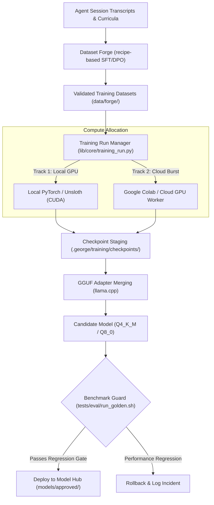

# Training Run Manager & Multi-Track Distillation

The **Training Run Manager** (`lib/core/training_run.py`, `commands/train.sh`) orchestrates the end-to-end continuous learning and fine-tuning lifecycle for Blue Lodge. It manages compute resource allocation across local GPUs and external cloud workers (Google Colab / RunPod), oversees checkpoint staging, runs multi-track SFT and DPO training, and merges resulting adapters into deployment-ready GGUF weights.



---

## 1. Multi-Track Training Architecture

Blue Lodge treats model training as an iterative, multi-track pipeline:

### Track 1: Local On-Device SFT
- Executed on the local operator GPU (e.g., RTX 3090, RTX 4090, or Proxmox GPU passthrough).
- Ideal for fast iteration on small domain datasets (tool syntax, error recovery, response styling).
- Uses memory-efficient 4-bit LoRA (QLoRA) via Unsloth or Hugging Face PEFT.

### Track 2: Remote Cloud Burst (Google Colab / Cloud Workers)
- Offloads heavy full-parameter or large DPO preference alignment runs to external compute.
- **Worker Lifecycle Management**:
  - Automatically provisions ephemeral worker sessions.
  - Monitors Colab compute units / credit consumption.
  - Heartbeat synchronization ensures long-running jobs are safely checkpointed before preemptive shutdown.
  - Automatically archives completed or stale worker sessions to avoid zombie compute charges.

---

## 2. Checkpoint Staging & GGUF Fusion

Once training runs complete:
1. **LoRA Extraction**: Intermediate adapter weights (`adapter_model.safetensors`) are validated against base model tensor dimensions.
2. **Multi-Track Fusion**: If separate specialized LoRAs were trained (e.g., Track A: POSIX tool execution; Track B: Cardano DEX math), the run manager merges them into the base model weights with configurable weighting ratios:
   $$W_{\text{merged}} = W_{\text{base}} + \alpha_A \Delta W_A + \alpha_B \Delta W_B$$
3. **Quantization & GGUF Packaging**: Converts merged FP16 weights into quantized GGUFs (`Q4_K_M`, `Q5_K_M`, or `Q8_0`) using the embedded `llama.cpp` toolchain.

---

## 3. The Benchmark Guard

Before any newly fine-tuned model profile can be activated in the lodge:
- The candidate GGUF is booted in an isolated sandbox port (`:8089`).
- **Automated Golden-Task Evaluation**: The test suite runs `tests/eval/run_golden.sh`.
- The candidate must score **>= 95%** on core tool calling, bash execution, and JSON schema formatting, and show zero regression on existing benchmarks.
- Only upon passing is the model moved to `models/approved/` and indexed into the [[MODELS|Model Workbench]].

---

## 4. CLI Operation

```bash
# Inspect active training runs and worker status
lodge /train status

# Launch an SFT training run using a Forge dataset
lodge /train run --recipe tool_calling_v2 --track local --epochs 3

# Launch a remote Colab worker run
lodge /train run --recipe code_reasoning_dpo --track colab --credits 20

# Merge checkpoint into GGUF
lodge /train merge --checkpoint .george/training/checkpoints/run_104 --quant Q4_K_M

# Run Benchmark Guard on candidate
lodge /train test --model candidate_model.gguf
```

---

## 5. Related Documentation
- [[DATASET_FORGE|Dataset Forge]] — Creating recipe-based SFT/DPO datasets from transcripts.
- [[MODELS|Model Workbench]] — Local GGUF management, profiling, and activation.
- [[BLUE_LODGE_LORA_TUNING_PLAYBOOK|LoRA Fine-Tuning Playbook]] — Hyperparameters and loss curves.
- [[SOVEREIGN_FOUNDATION_MODEL_PLAYBOOK|Sovereign Foundation Model Playbook]] — Architectural design.
- [[GYM|George Gym]] — Golden task evaluation workouts and benchmarks.
