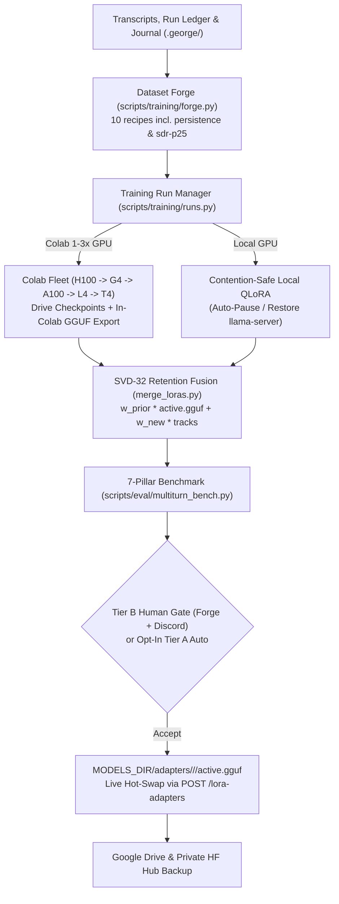

# Training Run Manager, Sleep-Cycle SVD-32 & Colab Fleet

Blue Lodge's training subsystem (`scripts/training/runs.py`, `scripts/training/forge.py`, `scripts/training/merge_loras.py`, `scripts/training/backup_artifacts.py`, `commands/train.sh`, and the **Training Forge** studio in `george-web`) implements a sovereign **Wake–Sleep Self-Improvement Loop** across both local GPUs and a 1–3× Google Colab GPU fleet.



---

## 1. Prerequisites & Google ADC Setup

Every Colab launch (CLI, Web Forge UI, or autonomous agent tool) runs `scripts/training/check_credits.py` + `runs.py plan` first and reports explicit readiness for:
- **Colab CLI** (`.venv/bin/colab`)
- **gcloud CLI** (`PATH` or `~/google-cloud-sdk/bin/gcloud`)
- **Google ADC** (`~/.config/gcloud/application_default_credentials.json`, mounted read-only into `deploy/george-web`) or **Colab OAuth2** (`~/.config/colab-cli/`)
- **Hugging Face Token** (`HF_TOKEN` in `.george/keys.conf`, required for gated models like `google/gemma-4-31b-it` and private HF backups)

Quick zero-`sudo` ADC setup on Linux / WSL2:
```bash
curl -fsSL https://dl.google.com/dl/cloudsdk/channels/rapid/downloads/google-cloud-cli-linux-x86_64.tar.gz | tar -xz -C "$HOME"
"$HOME/google-cloud-sdk/install.sh" --quiet --path-update true
source "$HOME/google-cloud-sdk/path.bash.inc"
gcloud auth application-default login --no-launch-browser
lodge /train credits
```

---

## 2. Colab GPU Fallback Cascade & 1-Hour Timeout Immunity

- **VRAM-Aware GPU Fallback:** `colab-cli` supports `H100` (80 GB), `G4` (96 GB RTX PRO 6000 Blackwell), `A100` (80 GB / 40 GB), `L4` (24 GB), and `T4` (16 GB). If provisioning the preferred GPU fails due to quota or regional availability, `runs.py` automatically steps down through `colab.gpu_fallback` (default `["H100", "G4", "A100", "L4", "T4"]`, filtered by `min_gpu_vram_gb`) and scales micro-batch size on lower-VRAM tiers.
- **1-Hour Timeout Checkpointing & Auto-Resume:** Colab sessions mount Google Drive (`colab drivemount /content/drive`), save checkpoints every `save_steps` (default 40) to `/content/drive/MyDrive/BlueLodge/checkpoints/<run>/<track>/`, and are automatically resumed via `runs.py resume <run>` (or `scripts/cron_system/training_watchdog.sh`) if a VM disconnects mid-run.
- **In-Colab GGUF Conversion:** `kit/train_lora.py --export-gguf` downloads stock `llama.cpp`'s `convert_lora_to_gguf.py` directly inside Colab while the HF base model metadata is cached, returning a ~150 MB `adapter.gguf` so local nodes never need a 60 GB HF weights copy on disk.
- **Base Model Sourcing:** Choose `base_source: "hf_direct"` (fastest on slow residential uploads — Colab pulls at datacenter speed), `"local_upload"`, or `"drive_mirror"`.

---

## 3. Role-Specific SVD-32 Lineage, Retention Weighting & Live Hot-Swapping

Adapters are stored per `(model_slug, role)` under `MODELS_DIR/adapters/`:
```text
MODELS_DIR/adapters/<model_slug>/<role>/
├── active.gguf      # symlink -> releases/v<N>-<run>-svd32.gguf
├── lineage.json     # ancestry, weights, benchmark scorecards, backup URIs
├── releases/        # immutable promoted versions
├── candidates/      # staged runs awaiting Tier B approval
└── tracks/          # preserved individual SFT/DPO track GGUFs
```
- **Retention Blending:** `merge_loras.py` blends the existing `active.gguf` (`prior_adapter_weight`, default `0.70`) with the new cycle's tracks (`0.30`) via Thin-QR SVD-32 so Sleep Cycles consolidate new lessons without catastrophic forgetting.
- **0ms On-the-Fly Switching:** Stock `llama-server` (`scripts/infra/start_inference.sh`) supports preloading multiple role adapters via `--lora-scaled` / `/models/active/current/adapters.conf` and switching active scales dynamically via `POST /lora-adapters` (`lodge /train hotswap --endpoint http://127.0.0.1:8080 --scales '[{"id":0,"scale":1.0}]'`).
- **Role Playbooks:** Ready-to-run JSON playbooks live in `configs/playbooks/` (`colab_gemma4_31b_svd32.json`, `colab_qwen27b_svd32.json`, `role_sdr_gemma4_e4b.json`, `local_qlora_sleep.json`), and Whisper-Small P25 audio LoRA training is preserved in `scripts/training/roles/sdr_whisper_p25.py`.

---

## 4. Sleep-Cycle Consolidation, Tier B Gate & Backups

- **Autonomous Agent Tools & ALP v1 Loop:** Agents can inspect readiness (`train_credits`, `train_pantry`), forge leak-guarded datasets (`train_forge` with `persistence` + `include_journal`), preflight/launch (`train_run_plan`, `train_run_start`), collect/merge (`train_run_collect_and_merge`), hot-swap (`train_adapter_hotswap`), and back up (`train_backup`), or run the declarative loop `data/workflows/loops/sleep-cycle-svd.loop.json`.
- **Tier B Default Gate (Toggleable to Tier A):** Finished runs are benchmarked with `scripts/eval/multiturn_bench.py` (7 Pillars + Early-Quit Rate) and staged in the **Forge UI Tier B Approval Table** + Discord notification (`lodge /train approve <run>` / `lodge /train deny <run>`). Operators can opt into **Tier A (Full Autonomy)** inside the Forge UI policy panel.
- **Cloud Backups:** `lodge /train backup backup --all --target both` archives promoted SVD-32 adapters and `lineage.json` to **Google Drive** and/or a **private Hugging Face Hub** repository.
