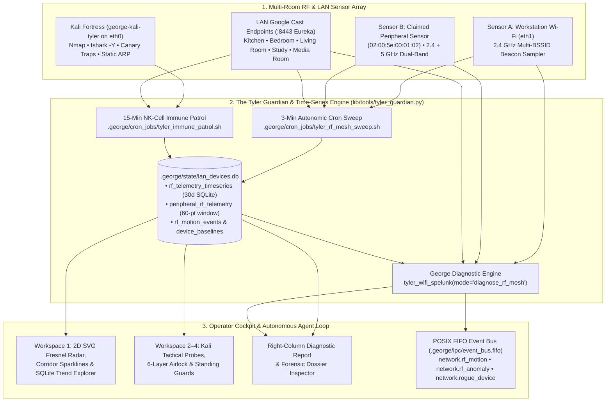
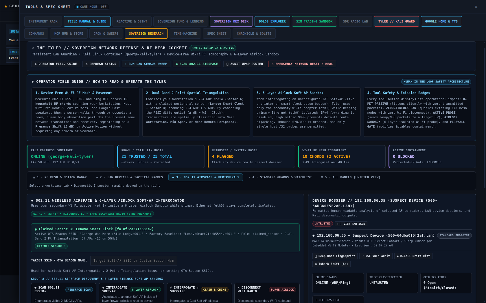
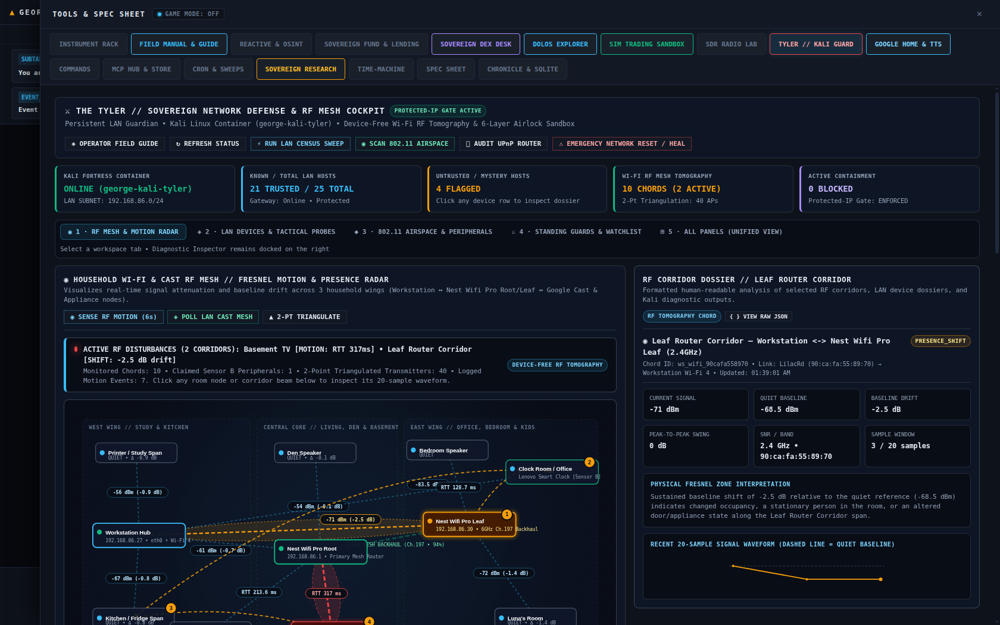
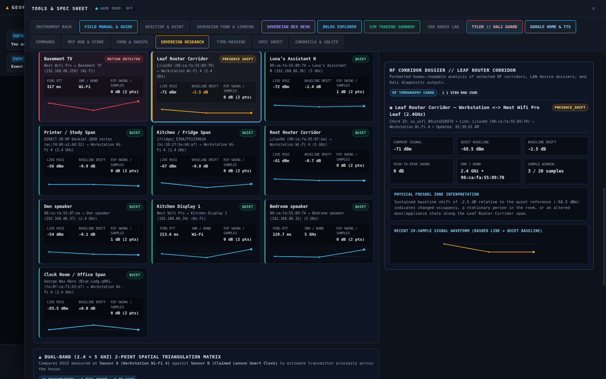
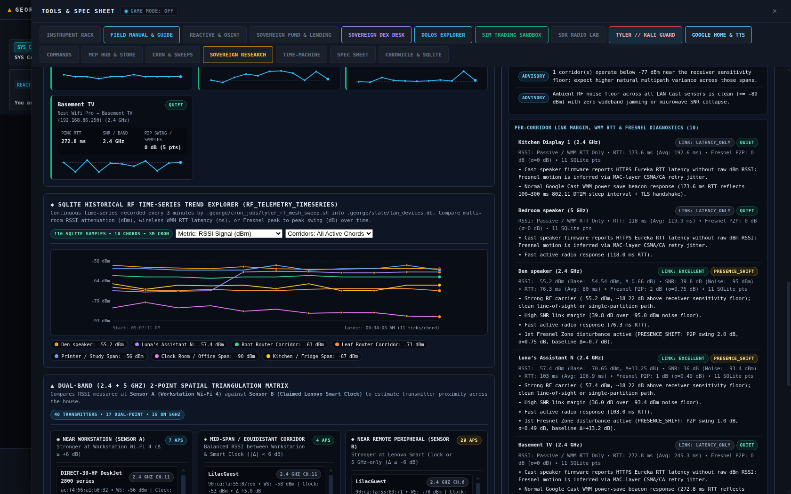
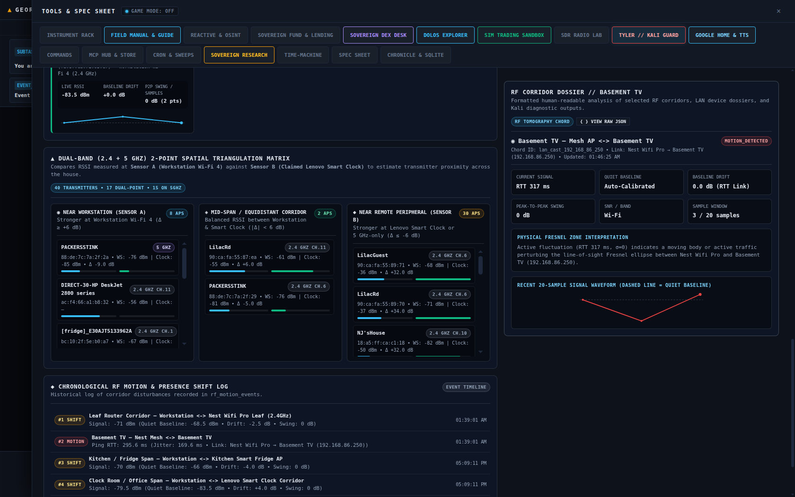
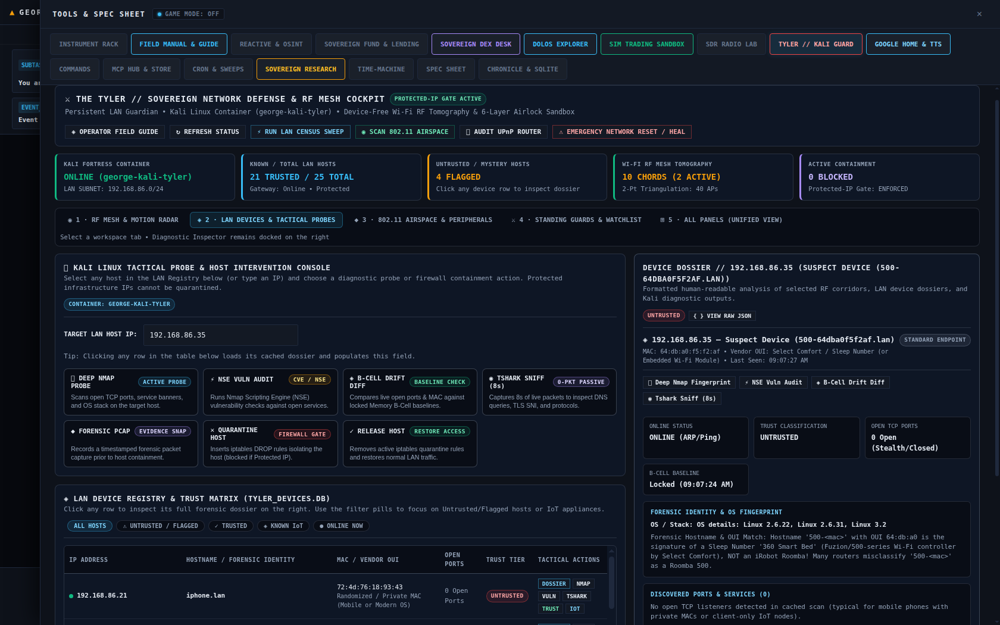
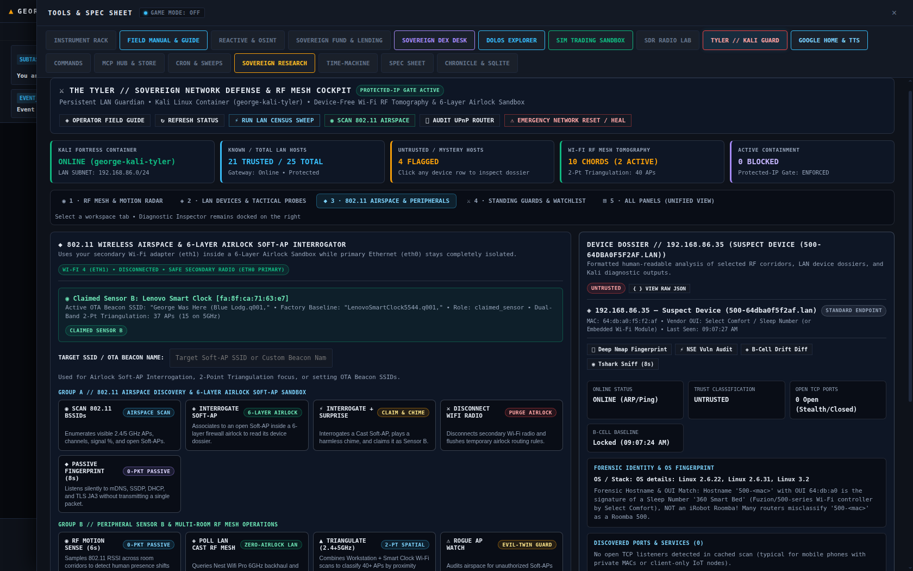
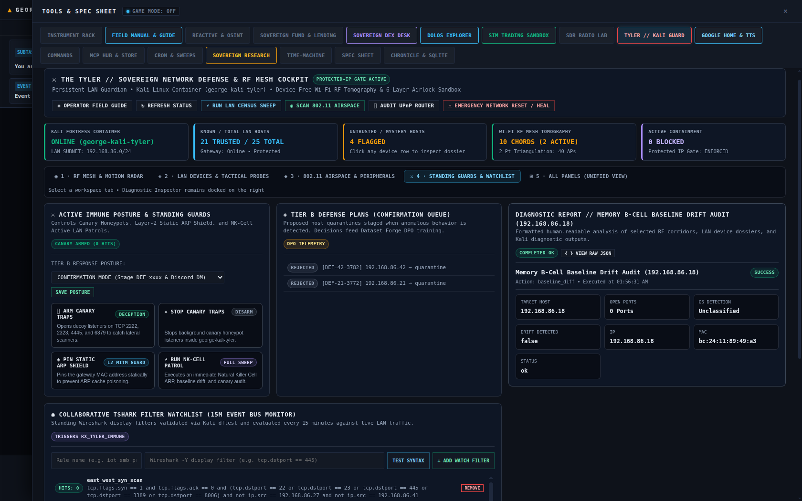

# The Tyler — Kali Linux Network Defense & Wi-Fi RF Mesh Tomography Operator Guide

> **Complete Operator Action Guide, RF Physics Reference (RSSI, SNR, Wireless RTT Latency & Fresnel Wave Ellipses), Compass-Calibrated Property Perimeter Guard (`perimeter_guard` — see [[PERIMETER_RF_SECURITY_BOM_AND_ARCHITECTURE]]), Autonomous Diagnostic Toolset, and Continuous SQLite Time-Series Architecture**

---

## 1. Overview & Architecture

**The Tyler (`#pane-tyler` // `TYLER // KALI GUARD`)** is the Blue Lodge's autonomous home network defense, active countermeasure, and **Device-Free Wi-Fi RF Tomographic Sensing** suite. It unifies two complementary defensive systems inside a single policy-gated cockpit:

1. **The Kali Linux Tactical Fortress (`george-kali-tyler`)**: A persistent, host-networked Kali Linux container equipped with `nmap`, `tshark`, `arp-scan`, `arping`, `p0f`, `whatweb`, `sslscan`, `avahi-browse`, `snmpwalk`, `upnpc`, `iptables`, and `scapy`, governed by a hardware-enforced **Protected-IP Policy Gate** (`192.168.1.1` Gateway, `192.168.1.10` George Host, `192.168.1.20` Operator Workstation — configured per node in `.george/config/tyler_household.json`) and RFC1918 private subnet enforcement.
2. **The Household Wi-Fi & Cast RF Tomographic Mesh**: A 10-corridor, 3-anchor wireless sensor array (`Wi-Fi Mesh Root/Leaf`, `Workstation Wi-Fi [Sensor A]`, and `Claimed Peripheral [Sensor B, 02:00:5e:00:01:02]`, plus LAN Cast room endpoints and smart appliances) that detects physical human movement, room occupancy shifts, and rogue 802.11 transmitters **without cameras, microphones, or wearable tags**.



---

## 2. RF Physics Reference: What RSSI, SNR, RTT Latency, and Fresnel Wave Ellipses Represent

A new operator looking at wireless telemetry will encounter four core physical quantities: **RSSI (`dBm`)**, **SNR (`dB`)**, **Wireless RTT Latency (`ms`)**, and **Fresnel Wave Ellipses**. Below is what each physical metric represents in the real world.

### 2.1 RSSI (Received Signal Strength Indicator, in `dBm`)

**RSSI** measures the power of a received radio wave referenced to **1 milliwatt ($1\text{ mW}$)** on a logarithmic decibel scale:

$$P_{\text{dBm}} = 10 \cdot \log_{10}\!\left(\frac{P_{\text{mW}}}{1\text{ mW}}\right)$$

Because a radio signal attenuates rapidly as it travels through air and walls, received Wi-Fi power is always a fraction of a milliwatt, meaning **RSSI values are negative numbers** (ranging from `-30 dBm` right next to an antenna down to `-90 dBm` at the edge of reception):

| RSSI (`dBm`) | Absolute Power (`mW`) | Physical Interpretation & Link Margin Grade |
| :--- | :--- | :--- |
| **`-30 dBm`** | `0.001 mW` ($1\,\mu\text{W}$) | **Immediate Proximity**: Transmitter is $<1\text{ m}$ from the receiving antenna with unobstructed line-of-sight. |
| **`-50 to -60 dBm`** | `10` to `1 nW` | **`EXCELLENT` Link**: Same room or separated by a single hollow drywall partition; $\ge 22\text{ dB}$ safety margin above the receiver floor. |
| **`-61 to -70 dBm`** | `0.8` to `0.1 nW` | **`GOOD` Link**: Multi-room household corridor spanning 1–2 walls; ideal sensitivity for Fresnel motion tomography. |
| **`-71 to -77 dBm`** | `0.08` to `0.02 nW` | **`FAIR` Link**: Multi-wall or cross-floor span; direct wave is attenuated, so multipath wall reflections carry a larger share of energy. |
| **`-78 to -88 dBm`** | `0.015` to `0.0015 nW` | **`WEAK_EDGE` Link**: Near the 802.11 receiver sensitivity floor (`~ -82 to -88 dBm`); small environmental shifts cause noticeable dB flutter. |

> [!TIP]
> **The 3 dB and 10 dB Rules of Thumb**
> - Every **`-3 dB`** drop means **50% of the radio wave's power was lost** (absorbed, reflected, or scattered).
> - Every **`-10 dB`** drop means **90% of the radio wave's power was lost**.
> - **Why Human Bodies Perturb RSSI**: At $2.4\text{ GHz}$ ($\lambda = 12.5\text{ cm}$) and $5\text{ GHz}$ ($\lambda = 6.0\text{ cm}$), the dielectric constant of water absorbs and scatters microwave energy strongly. Because the human body is **~70% water and dissolved electrolytes**, a person stepping across a Wi-Fi corridor absorbs the direct path and alters wall reflections, producing an immediate **`2.0 to 6.0 dB` peak-to-peak RSSI swing (`p2p_swing_db`)**.

In The Tyler, each corridor tracks three RSSI sub-metrics:
- **Quiet Baseline (`baseline_rssi_dbm`)**: The steady-state RSSI of the room when unoccupied (drawn as a **dashed horizontal line** on every corridor sparkline). During quiet periods, The Tyler applies an $85\% / 15\%$ exponential smoothing filter so slow day/night temperature/humidity drift never causes false alarms.
- **Baseline Drift (`baseline_drift_db`, $\Delta\text{dB}$)**: $\text{Current Mean RSSI} - \text{Quiet Baseline}$. A sustained shift ($\lvert\Delta\rvert \ge 2.5\text{ dB}$) with low rapid swing means a stationary change occurred in the room (e.g., a person sitting at a desk, or a heavy appliance/door moved).
- **Peak-to-Peak Swing (`p2p_swing_db`) & Standard Deviation (`std_db`, $\sigma$)**: Within a 6-second multi-tick sampling window, `p2p_swing_db = max(RSSI) - min(RSSI)`. Rapid oscillation ($\text{P2P} \ge 3.0\text{ dB}$ or $\sigma \ge 1.15\text{ dB}$) indicates active physical motion through the corridor.

---

### 2.2 RF Noise Floor (`noise_level_dbm`) & Signal-to-Noise Ratio (`snr_db`)

Even when no Wi-Fi device is transmitting, the $2.4\text{ GHz}$ and $5\text{ GHz}$ bands contain background thermal and electromagnetic noise called the **RF Noise Floor** (typically **`-85 to -95 dBm`** in a quiet home).

$$\text{SNR (dB)} = \text{RSSI}_{\text{dBm}} - \text{Noise Floor}_{\text{dBm}}$$

- Example: In the **Living Room speaker** corridor (`192.168.1.52`), `RSSI = -55 dBm` and `Noise Floor = -85 dBm`, yielding **`SNR = +30 dB`** (meaning the desired Wi-Fi signal is $1,000\times$ more powerful than background noise).
- **Interference & Jamming Detection**: If an unshielded microwave oven, analog wireless video transmitter, cordless phone, or deliberate RF jammer activates in a room, the noise floor spikes (e.g., from `-88 dBm` up to `-65 dBm`). Whenever `poll_lan_peripherals()` observes **`noise_level_dbm > -70 dBm`** or **`snr_db < 8 dB`**, The Tyler automatically emits a `network.rf_anomaly` alert onto `.george/ipc/event_bus.fifo`.

---

### 2.3 Wireless RTT Latency (`rtt_ms`) & WMM Power-Save Jitter (`rtt_jitter_ms`)

**RTT (Round-Trip Time)** measures the elapsed time in milliseconds (`ms`) for The Tyler to send an encrypted TCP/TLS request over the home Wi-Fi mesh to a peripheral's local diagnostic endpoint (`https://<ip>:8443/setup/eureka_info` on Google Cast devices or `http://<ip>/api/v1/status` on Nest Wifi Pro routers) and receive the complete JSON payload back.

Why do idle Google Home / Nest speakers often show **`160 ms to 330 ms` RTT** on a local LAN where wired ping is `<1 ms`?

1. **802.11 WMM Power-Save (DTIM Beacon Sleeping)**: Smart speakers and displays keep their Wi-Fi radios in low-power sleep (`PS-Poll` / U-APSD) between 802.11 Delivery Traffic Indication Map (DTIM) beacons, waking up every **`100 to 300 ms`** to check if the router has buffered frames for them. Thus, a steady `180–340 ms` RTT is completely normal WMM power-save behavior.
2. **Why RTT Jitter Detects Motion When Firmware Hides dBm**: Certain Google Cast speaker firmware revisions report `rtt_ms` and `wpa_state` over `:8443/setup/eureka_info` without exposing raw integer `signal_level` dBm (labeled `LINK: LATENCY_ONLY` in diagnostics, such as `Kitchen Display 1`, `Bedroom speaker`, and `Basement TV`). When a human body walks across the radio link to those speakers:
   - Shadowing causes instantaneous multipath fade,
   - The 802.11 radio drops its Modulation and Coding Scheme (MCS) rate and performs MAC-layer CSMA/CA frame retries,
   - Round-trip latency spikes erratically, elevating **RTT Jitter (`rtt_jitter_ms`, the standard deviation of warm RTT ticks)**. The Tyler flags `PRESENCE_SHIFT` at `rtt_jitter >= 65 ms` and `ACTIVE_MOTION` at `rtt_jitter >= 95 ms`.

---

### 2.4 What Fresnel Wave Ellipses Represent

A common misconception is that a Wi-Fi signal travels between a Transmitter ($TX$) and Receiver ($RX$) as a pencil-thin laser beam. In electromagnetic physics, because radio waves have a finite wavelength ($\lambda \approx 12.5\text{ cm}$ at $2.4\text{ GHz}$ and $\lambda \approx 6.0\text{ cm}$ at $5\text{ GHz}$), wavefronts expand outward and fill a **3-dimensional cigar-shaped volume** between the two antennas called the **Fresnel Zones** (named after physicist Augustin-Jean Fresnel).

```
                     1st Fresnel Zone Ellipsoid (r₁ ≈ 0.35m – 0.55m)
                    . - ~ ~ ~ - . _ _ _ _ _ _ _ _ _ . - ~ ~ ~ - .
               . '                 ↑                             ' .
            . '                    │ r₁ = √(λ·d₁·d₂ / d)            ' .
   [TX Node] ──────────────────────┼──────────────────────────────────── [RX Node]
  (Nest Root)       Direct Wave (d₁)               (d₂)              (Room Sensor)
            . _                    │   🧍 Human Body                  _ .
               ' .                 ↓  (Scatters & Phase-Shifts)   . '
                    ' - . _ _ . - ' ‾ ‾ ‾ ‾ ‾ ‾ ‾ ‾ ' - . _ _ . - '
```

At any point located distance $d_1$ from the transmitter and $d_2$ from the receiver along a corridor of total length $d = d_1 + d_2$, the radius $R_n$ of the $n$-th Fresnel zone is:

$$R_n = \sqrt{\frac{n \cdot \lambda \cdot d_1 \cdot d_2}{d_1 + d_2}} \qquad \Longrightarrow \qquad r_1\text{ (at midpoint } d_1 = d_2 = d/2\text{)} = \frac{1}{2}\sqrt{\lambda \cdot d}$$

#### Concrete Household Numbers
- Across an **$8\text{-meter}$ household corridor** at **$2.4\text{ GHz}$** ($\lambda = 0.125\text{ m}$):
  $$r_1 = \frac{1}{2}\sqrt{0.125 \times 8.0} = \frac{1}{2}\sqrt{1.0} = 0.50\text{ meters} \quad (\text{a } 1.0\text{-meter wide ellipse})$$
- Across an **$8\text{-meter}$ household corridor** at **$5.0\text{ GHz}$** ($\lambda = 0.060\text{ m}$):
  $$r_1 = \frac{1}{2}\sqrt{0.060 \times 8.0} \approx 0.35\text{ meters} \quad (\text{a } 0.70\text{-meter wide ellipse})$$

#### How Multipath Interference Inside the Fresnel Ellipse Detects Movement
1. **The 1st Fresnel Zone (`n = 1`)** is the primary cigar-shaped ellipse drawn on The Tyler's 2D SVG radar. Every wave path inside the 1st Fresnel zone travels at most $\lambda / 2$ ($180^\circ$ of phase) longer than the direct line-of-sight path, so these waves combine **constructively** at the receiving antenna.
2. **Reflections from the boundary of the 1st and 2nd Fresnel Zones** arrive $180^\circ$ out of phase and interfere **destructively** with the direct wave.
3. When a person walks into or moves within a corridor's Fresnel ellipse:
   - They alternately block the direct path (attenuation dip) and reflect outer-zone paths (constructive/destructive phase oscillation),
   - This creates a characteristic undulating RSSI waveform (a **Fresnel diffraction ripple** of `2.0 to 6.0 dB`),
   - On the 2D SVG radar (`#tylerMeshRadarContainer`), The Tyler visualizes this physically:
     - **Quiet Corridor (`quiet`)**: Thin steady cyan chord (`#38bdf8`), no expanded ellipse.
     - **Presence Shift (`presence_shift`)**: Amber dashed chord (`#f59e0b`) + translucent **Amber 1st Fresnel Zone Ellipse** spanning the corridor (`p2p_swing_db >= 2.0 dB`, `std_db >= 0.65 dB`, or `|baseline_drift_db| >= 2.5 dB`).
     - **Active Motion (`motion_detected`)**: Crimson animated chord (`#ef4444`) + pulsing **Crimson 1st & 2nd Fresnel Wave Ellipses** + expanding target ring (`p2p_swing_db >= 3.0 dB`, `std_db >= 1.15 dB`, or `rtt_jitter_ms >= 95 ms`).

---

## 3. Visual Operator Action Guide (Workspace-by-Workspace)

### 3.1 Top Posture Header, Mode Tabs & Operator Field Guide Drawer

At the top of `TYLER // KALI GUARD`, five live KPI cards summarize your defensive and spatial posture at a glance:
1. **KALI CONTAINER**: Shows whether `george-kali-tyler` is online on the LAN bridge.
2. **KNOWN / TOTAL DEVICES**: Count of trusted + known IoT endpoints vs. total ARP-discovered hosts.
3. **UNTRUSTED / MYSTERY**: Count of flagged or unidentified MAC addresses requiring inspection.
4. **ACTIVE COUNTERMEASURES**: Count of active `iptables` quarantines and Protected-IP Gate status.
5. **RF MESH & MOTION SENSE**: Count of monitored RF chords and active Fresnel presence/motion corridors.

Clicking **`? OPERATOR FIELD GUIDE`** (`#btnTylerGuideToggle`) opens a collapsible reference drawer right inside the cockpit explaining all five Safety/Emission Badges (`0-PKT PASSIVE`, `ZERO-AIRLOCK LAN`, `ACTIVE PROBE`, `6-LAYER AIRLOCK`, `FIREWALL GATE`), Fresnel physics, and the 6-Layer Airlock:



---

### 3.2 Workspace 1: RF Mesh & Motion Radar (`1 · RF Mesh & Motion Radar`)

Workspace 1 is the primary spatial awareness view. It contains four coordinated panels on the left and the interactive **Diagnostic Report & Dossier Inspector** on the right:

#### A. 2D SVG Household RF Mesh & Fresnel Corridor Radar
Displays your three primary radio anchors (`Wi-Fi Mesh Root`, `Workstation Wi-Fi [Sensor A]`, and `South-Wall Peripheral [Sensor B]`) at the center, surrounded by your configured room endpoints (`Kitchen Display`, `Kitchen Appliance`, `Bedroom Speaker`, `Living Room Speaker`, `Guest Room`, `Media Room`, `Study Printer`, and `Wi-Fi Mesh Leaf`).
- **Click any room node or Fresnel ellipse** to immediately open its **Corridor Dossier** in the right-hand Inspector (showing Current Signal, Quiet Baseline, Baseline Drift, Peak-to-Peak Swing, SNR/Band, a plain-English Physical Fresnel Zone Interpretation, and a 60-sample waveform):



#### B. Multi-Room RF Corridor Telemetry Cards
Below the radar, each of the 10 corridors has its own telemetry card showing its status badge (`QUIET`, `PRESENCE SHIFT`, `ACTIVE MOTION`), `TX <-> RX` endpoint pair, current RSSI (`dBm`) or Ping RTT (`ms`), SNR/Band, Peak-to-Peak Swing (`dB`), and a live SVG sparkline where the **dashed horizontal line** marks the quiet-room baseline:



#### C. SQLite Historical RF Time-Series Trend Explorer & Automated Diagnostics (`diagnose_rf_mesh`)
Directly below the corridor cards sits the **SQLite Historical RF Time-Series Trend Explorer (`#tylerRfTrendCard`)**, backed by the `rf_telemetry_timeseries` table in `.george/state/lan_devices.db`:
- Switch the **Metric Selector** between:
  - `Metric: RSSI Signal (dBm)` — multi-room signal attenuation and baseline drift over time.
  - `Metric: Wireless RTT Latency (ms)` — WMM sleep-cycle latency and CSMA/CA retry spikes over time.
  - `Metric: Fresnel P2P Swing (dB)` — peak-to-peak disturbance intensity relative to the `2.0 dB` threshold line.
- Use the **Corridors Selector** to view all active chords overlaid or isolate a single room.
- Click **`⚡ DIAGNOSE RF MESH & TRENDS`** (`#btnTylerRadarDiagnoseQuick`) in the radar header to run Brother George's automated diagnostic engine (`diagnose_rf_mesh`), which grades every corridor's link margin, SNR health, WMM RTT latency, and Fresnel disturbance history in the right-hand Inspector:



#### D. Dual-Band (2.4 + 5 GHz) 2-Point Spatial Triangulation Matrix & Motion Log
Compares the RSSI of every nearby 802.11 transmitter as heard by **Sensor A (`Workstation Wi-Fi 4` on `eth1`)** vs. **Sensor B (`Claimed Lenovo Smart Clock` on 2.4 + 5 GHz)**:
- Computes differential attenuation ($\Delta\text{dB} = \text{RSSI}_{\text{WS}} - \text{RSSI}_{\text{Clock}}$) and groups all discovered APs into three spatial columns:
  1. **`NEAR WORKSTATION (SENSOR A)`** ($\Delta \ge +6\text{ dB}$)
  2. **`MID-SPAN / EQUIDISTANT CORRIDOR`** ($\lvert\Delta\rvert < 6\text{ dB}$)
  3. **`NEAR REMOTE PERIPHERAL (SENSOR B)`** ($\Delta \le -6\text{ dB}$ or $5\text{ GHz}$-only)



---

### 3.3 Workspace 2: LAN Devices & Tactical Probes (`2 · LAN Devices & Tactical Probes`)

Workspace 2 is your wired/wireless LAN host interrogation and containment console:



#### Operator Playbook for Investigating an Unknown or Suspect LAN Device
1. **Filter & Select (Zero Packets Emitted)**:
   - Click the **`UNTRUSTED / FLAGGED`** filter pill above the LAN Device Registry table, or click any row (e.g., `192.168.1.35 — Suspect Device` or `192.168.1.28 — Unidentified Device`).
   - Selecting a row immediately populates the target IP into the Kali Probe Console and opens its cached **Device Dossier** in the right-hand Inspector (`0 packets emitted`), displaying its MAC OUI vendor, Memory B-Cell baseline open ports, and forensic identity clues.
2. **Run Targeted Kali Probes (`ACTIVE PROBE`)**:
   - **Deep Nmap Fingerprint**: Runs `nmap -sV -O --version-light` + mDNS/SSDP/HTTP banner harvesting inside `george-kali-tyler`.
   - **NSE Vuln Audit**: Runs Nmap Scripting Engine (`--script vuln,auth,default`) against discovered open ports to test for CVEs or default credentials.
   - **Memory B-Cell Drift Diff**: Compares the host's live open TCP ports and service banners against its stored SQLite `device_baselines` snapshot to catch newly opened backdoors or firmware drift.
   - **8s Live tshark Capture**: Captures 8 seconds of live packets from/to the target IP on `eth0`, extracting DNS queries, TLS SNI server names, and protocol counts into the right-hand Inspector.
   - **Forensic PCAP Snapshot**: Saves a raw `.pcap` file in `.george/state/pcaps/` for offline Wireshark inspection.
3. **Classify Trust or Quarantine (`FIREWALL GATE`)**:
   - Click **`TRUST`** or **`IOT`** on the device row to update its standing trust tier in `lan_devices.db`.
   - Click **`Quarantine Host`** (or **`Release Quarantine`**) to insert/remove an `iptables` DROP rule inside the Kali defense bridge. Destructive actions prompt a non-blocking inline confirmation bar and are hardware-blocked on Protected Infrastructure IPs (`.1`, `.27`, `.41`).

---

### 3.4 Workspace 3: 802.11 Airspace & Peripherals (`3 · 802.11 Airspace & Peripherals`)

Workspace 3 controls your secondary wireless interface (`Wi-Fi 4 / eth1`), your Claimed Sensor B (`Lenovo Smart Clock`), and the **6-Layer Airlock Soft-AP Interrogator**:



#### How the 6-Layer Airlock Sandbox Works
When an unconfigured smart device or suspicious appliance broadcasts an **Open Soft-AP** (e.g., `LenovoSmartClock5544.q001` or a rogue setup network), connecting a normal computer to it is dangerous because the OS might route internet/LAN traffic through the untrusted AP. The Tyler's **6-Layer Airlock (`interrogate_soft_ap`)** eliminates this risk:
1. **Layer 1 (Interface Pinning)**: Pins primary LAN routes to wired `eth0` so WSL2 and host traffic never switches default gateways.
2. **Layer 2 (Metric Demotion)**: Sets interface metric `9999` on secondary `Wi-Fi 4 (eth1)`.
3. **Layer 3 (Firewall Lockdown)**: Blocks all inbound connections and blocks outbound traffic from `eth1` except to the isolated `/29` Soft-AP setup host (`192.168.255.249` ports `80, 443, 8008, 8443`).
4. **Layer 4 (Watchdog Timer)**: Arms a 45-second background kill-switch that forces radio disconnection even if the process crashes.
5. **Layer 5 (Eureka Interrogation)**: Queries `:8008/setup/eureka_info`, `:8008/setup/offer` (RSA-2048 public key), and `:8008/setup/scan_results` (capturing all 2.4 GHz and 5 GHz BSSIDs visible from that room).
6. **Layer 6 (Clean Teardown)**: Disconnects `Wi-Fi 4`, deletes the temporary WLAN profile, removes temporary firewall rules, and disarms the watchdog.

---

### 3.5 Workspace 4: Standing Guards & Watchlist (`4 · Standing Guards & Watchlist`)

Workspace 4 manages autonomous 24/7 background defenses and your collaborative Wireshark (`tshark -Y`) display filter watchlist:



- **Arm Canary Traps (`2222 / 2323 / 4445 / 6379`)**: Runs a lightweight decoy listener daemon (`canary-daemon`) on SSH-alt (`2222`), Telnet-alt (`2323`), SMB-alt (`4445`), and Redis (`6379`). Any LAN device that probes these ports has its source IP, MAC, and payload banner logged to `canary_hits` and triggers an immediate `network.canary_triggered` event.
- **Pin Static ARP Shield**: Locks your router gateway (`192.168.1.1 -> 02:00:5e:00:00:01`) as a `PERMANENT` Layer-2 neighbor entry in the Linux kernel ARP table, preventing ARP cache poisoning / MITM attacks.
- **Collaborative `tshark` Filter Watchlist**: Lets you or Brother George register custom Wireshark display filters (validated via Kali's `dftest` binary before insertion) that are evaluated every 15 minutes during the Natural Killer Cell LAN patrol.

---

## 4. Brother George's Autonomous Collection & Diagnostic Toolset

Brother George has full programmatic access to collect, triangulate, and diagnose all LAN and RF mesh telemetry through both native function calling ([`data/schemas/native_tools.json`](../data/schemas/native_tools.json)) and the stdio MCP server ([`lib/tools/mcp_server_tyler.py`](../lib/tools/mcp_server_tyler.py)):

| Tool Name | Mode / Arguments | Purpose & What George Collects / Diagnoses |
| :--- | :--- | :--- |
| **`tyler_wifi_spelunk`** | `mode="diagnose_rf_mesh"`, `timeout=24`, `surprise=false` | **Automated RF Health & Time-Series Diagnostic Engine**: Queries the SQLite `rf_telemetry_timeseries` over the last `timeout` hours (optionally running a fresh 4s sample pass first if `surprise=true`). Grades every corridor's **Link Margin** (`EXCELLENT`, `GOOD`, `FAIR`, `WEAK_EDGE`, `LATENCY_ONLY`), **SNR & Noise Floor Health**, **WMM RTT Latency**, and **Fresnel Disturbance Profile**, and returns plain-English findings and calibration recommendations. |
| **`tyler_wifi_spelunk`** | `mode="rf_motion_sense"`, `timeout=6`, `surprise=false` | **Device-Free RF Tomographic Motion & Presence Sensor**: Concurrently samples all 10 household RF chords over `timeout` seconds, computes mean RSSI, noise floor, SNR, RTT, RTT jitter, `std_db`, `p2p_swing_db`, and `baseline_drift_db`, logs to `rf_telemetry_timeseries`, and emits `network.rf_motion` if movement is detected. Passing `surprise=true` recalibrates quiet-room baselines. |
| **`tyler_wifi_spelunk`** | `mode="poll_lan_peripherals"` | **Zero-Airlock Multi-Room Cast & Mesh Sweep (`<1.5s`)**: Concurrently polls `:8443/setup/eureka_info` across all 5 LAN Google Cast rooms and `:80/api/v1/status` on Nest Wifi Pro routers, recording RSSI/SNR/RTT into `rf_telemetry_timeseries` and alerting on noise spikes (`> -70 dBm`). |
| **`tyler_wifi_spelunk`** | `mode="triangulate_airspace"` | **Dual-Band (2.4+5 GHz) 2-Point Spatial Triangulation**: Fuses 802.11 scans from Workstation Sensor A (`eth1`) and Claimed Peripheral Sensor B (`Lenovo Smart Clock`) to localize every BSSID across the house. |
| **`tyler_wifi_spelunk`** | `mode="rogue_ap_watch"` / `mode="canary_ap_watch"` | Hunts for Evil-Twin / unauthorized Soft-APs or sweeps the `/29` Soft-AP honeypot subnet for unauthorized client associations. |
| **`tyler_baseline_diff`** | `ip="all"` or `ip="192.168.1.x"` | **Memory B-Cell Drift Detector**: Compares current open ports and service banners against stored `device_baselines` snapshots. |
| **`tyler_deep_fingerprint`** / **`tyler_vuln_audit`** | `ip="192.168.1.x"` | Executes deep Nmap OS/service banner fingerprinting or NSE vulnerability auditing inside `george-kali-tyler`. |
| **`tyler_kali_man`** / **`tyler_kali_exec`** | `tool="nmap"`, `command="..."` | Consults curated recipes + live Kali man pages and runs policy-gated Kali recon commands against RFC1918 targets. |

### CLI Usage Examples
You or Brother George can also run the diagnostic and collection engine directly from the terminal:
```bash
# 1. Run a 24-hour RF Mesh & SQLite Time-Series Diagnostic Audit
python3 lib/tools/tyler_guardian.py wifi-spelunk --mode diagnose_rf_mesh --timeout 24

# 2. Run a fresh 6-second multi-room Fresnel motion sensing pass
python3 lib/tools/tyler_guardian.py wifi-spelunk --mode rf_motion_sense --timeout 6

# 3. Recalibrate quiet-room RF baselines when all rooms are unoccupied
python3 lib/tools/tyler_guardian.py wifi-spelunk --mode rf_motion_sense --timeout 6 --surprise
```

---

## 5. Continuous 15-Second In-Process Sampling, 4-Stage Signal Conditioning & 2-Tier SQLite Retention

RF mesh scans run every **15 seconds (`0.067 Hz`)** in-process inside the resident `canary-daemon` (`run_canary_daemon_loop()` -> `_rf_15s_sampler_loop()`) supervised by `.george/cron_jobs/tyler_rf_mesh_sweep.sh`, with zero process-fork overhead (`~12–18 ms` CPU per 15s cycle, or `0.1%` of 1 core, and `0.4 KB/s` LAN traffic).

### 5.1 4-Stage RF Signal Conditioning Pipeline (`rf_motion_sense`)

Every 15-second sample across all 10 household RF corridors passes through a 4-stage digital signal processing pipeline before updating corridor states:

1. **Stage 1 — 3-Point Hampel Spike Clamp (Non-Linear Outlier Rejection)**:
   - Computes the 5-sample sliding median $m_t$ and scaled Median Absolute Deviation $\sigma_{\text{MAD}} = 1.4826 \times \text{median}(\lvert x_i - m_t\rvert)$.
   - Any single-tick 802.11 beacon collision spike exceeding $3\sigma_{\text{MAD}}$ (min $2.5\text{ dB}$) that reverts on the next sample is clamped to $m_t$, eliminating transient interference false positives without blurring real step changes.
2. **Stage 2 — Dual-Timescale State-Gated EWMA ($\alpha_{\text{fast}} = 0.35$, $\alpha_{\text{slow}} = 0.02$)**:
   - **Fast EWMA ($\alpha_{\text{fast}} = 0.35$, $\tau \approx 35\text{ s}$)**: Smooths out $\pm 0.5\text{ dB}$ 1-dB integer ADC quantization chatter while tracking human room entry within 1–2 ticks (15–30 seconds):
     $$\text{EWMA}_{\text{fast}}(t) = 0.35\,\tilde{x}_t + 0.65\,\text{EWMA}_{\text{fast}}(t-1)$$
   - **State-Gated Slow Baseline EWMA ($\alpha_{\text{slow}} = 0.02$, $\tau \approx 12.5\text{ min}$)**: Adapts to gradual barometric/temperature drift *only* when `motion_state == "quiet"`. The baseline freezes during `presence_shift` and `motion_detected` so a stationary occupant sitting in a room is never absorbed into the empty-room reference.
3. **Stage 3 — EWMA Volatility ($\sigma_{\text{ewma}}, \beta = 0.20$) & Adaptive SNR Z-Score ($Z_t$)**:
   - Normalizes the Fast-vs-Slow EWMA divergence by each link's noise floor ($\sigma_{\text{floor}} = 0.55\text{ dB}$ on strong links $\ge -72\text{ dBm}$, vs. $0.95\text{ dB}$ on weak edge links like `-79 dBm`):
     $$Z_t = \frac{\text{EWMA}_{\text{fast}}(t) - \text{EWMA}_{\text{slow}}(t)}{\max(\sigma_{\text{ewma}}(t), \sigma_{\text{floor}})}$$
4. **Stage 4 — Two-Sided Page-Hinkley CUSUM ($S_t^+, S_t^-$)**:
   - Accumulates sustained small attenuation shifts exceeding slack $\delta = 0.75\text{ dB}$ (`cusum_db`, triggering `presence_shift` at $\lvert S_t \rvert \ge 3.5\text{ dB}$), providing high sensitivity to stationary room occupancy even when intra-tick variance is zero.

### 5.2 Scheduled Daemon & Cron Jobs (`.george/cron_jobs/`)

| Component / Cron Job | Cadence | What It Executes |
| :--- | :--- | :--- |
| **`canary-daemon` (`_rf_15s_sampler_loop`)** | **Every 15 seconds (`in-process`)** | Runs `rf_motion_sense(duration=2)` inside a background thread of the resident Python daemon, updating all 10 RF corridors with zero process-spawn overhead. |
| **[`.george/cron_jobs/tyler_rf_mesh_sweep.sh`](../.george/cron_jobs/tyler_rf_mesh_sweep.sh)** | **Every 60 seconds (`INTERVAL: 60`)** | Supervises `canary-daemon` (auto-restarting if needed), runs a catch-up sweep if the latest SQLite sample is `>25s` old, and triggers `prune_tyler_state()` for 2-tier RRD compaction. |
| **[`.george/cron_jobs/tyler_immune_patrol.sh`](../.george/cron_jobs/tyler_immune_patrol.sh)** | **Every 15 minutes (`INTERVAL: 900`)** | Verifies Canary Honeypot traps (`2222, 2323, 4445, 6379`), enforces the `PERMANENT` Layer-2 ARP shield on the configured gateway, runs a 10-second East-West `tshark` watchlist capture, and audits LAN peripherals. |

### 5.3 2-Tier SQLite Time-Series Schema & Retention Policy (`.george/state/lan_devices.db`)

All wireless telemetry is stored in `.george/state/lan_devices.db` configured with `PRAGMA journal_mode=WAL` and `PRAGMA synchronous=NORMAL`:

1. **Tier 1 — High-Resolution Raw Table (`rf_telemetry_timeseries`, 15-Second Granularity, 72-Hour Retention)**:
   - Stores `rssi_dbm`, `ewma_fast_dbm`, `baseline_rssi_dbm`, `ewma_std_db`, `z_score`, `cusum_db`, `noise_dbm`, `snr_db`, `rtt_ms`, `rtt_jitter_ms`, `std_db`, `p2p_swing_db`, and `motion_state`.
   - Indexed by `(chord_id, ts DESC)`. Retaining **72 hours (3 days)** at 15s across 10 corridors caps Tier 1 at `~172,800 rows` (`~23 MB`).
2. **Tier 2 — Downsampled 5-Minute Rollup Table (`rf_telemetry_rollup_5m`, 5-Minute Granularity, 90-Day Retention)**:
   - `prune_tyler_state()` automatically aggregates raw rows older than 72 hours into 5-minute buckets (`PRIMARY KEY (chord_id, bucket_ts)`), preserving `samples_count`, `min/max/avg_rssi_dbm`, `avg_ewma_fast_dbm`, `avg_baseline_dbm`, `max_abs_z_score`, `max_abs_cusum_db`, `avg/max_rtt_ms`, `max_p2p_swing_db`, `presence_shift_ticks`, and `motion_ticks` for **90 days** (`~259,200 rows`, `~32 MB`).
3. **`peripheral_rf_telemetry` & `rf_motion_events`**:
   - Stores the latest conditioned corridor state + 60-sample rolling window (`history_json`) and the chronological event ledger of every `presence_shift` and `motion_detected` transition.
